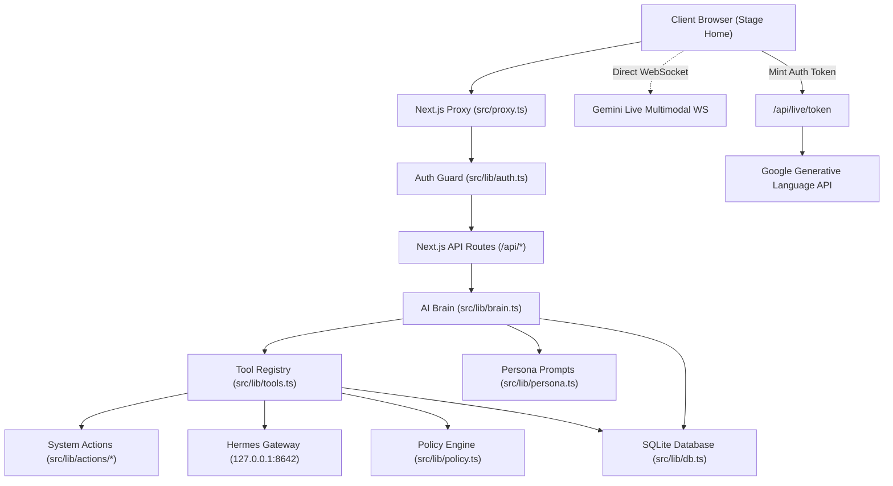

# Phase 0 — System Architecture & Topology

## 1. System Topology Overview

Sofia operates as a hybrid edge/cloud personal AI assistant with three distinct deployment tiers:

```
 ┌────────────────────────────────────────────────────────────────────────┐
 │                              CLIENT LAYER                              │
 │                                                                        │
 │  Browser / Web Client (http://localhost:3000)                          │
 │  ├── SofiaStageHome (Center Avatar + Sliding Dual Rails)              │
 │  ├── SofiaLiveSession (Web Audio API, AudioWorklet, 16kHz PCM)         │
 │  └── Web Speech API / Edge TTS Playback / LocalStorage Token Cache     │
 └───────────────────────┬───────────────────────────┬────────────────────┘
                         │ HTTPS / WebSocket         │ Direct WSS
                         ▼                           ▼
 ┌──────────────────────────────────────┐  ┌──────────────────────────────┐
 │             SERVER TIER              │  │      EXTERNAL CLOUD APIS     │
 │                                      │  │                              │
 │  Next.js 16 (App Router + Proxy)     │  │  Google Gemini 3.8 Live API  │
 │  ├── src/proxy.ts (Token Guard)      │  │  (wss://generativelanguage...)│
 │  ├── src/lib/brain.ts (Orchestrator) │  │                              │
 │  ├── src/lib/tools.ts (22 Tools)     │  │  LiteLLM AI Proxy            │
 │  ├── src/lib/tts.ts (Edge/ElevenLabs)│  │  (https://ai-proxy.zenova...) │
 │  └── src/lib/proactive.ts (Scheduler)│  │                              │
 │                                      │  │  ElevenLabs / Edge TTS       │
 └──────────────────┬───────────────────┘  └──────────────────────────────┘
                    │ Synchronous C++ Binding
                    ▼
 ┌──────────────────────────────────────┐  ┌──────────────────────────────┐
 │            DATA STORAGE              │  │    LOCAL MACHINE CONTROL     │
 │                                      │  │                              │
 │  SQLite 3 (data/sofia.db)            │  │  Hermes Bridge Gateway       │
 │  ├── 16 relational tables            │  │  (127.0.0.1:8642 / 8644)     │
 │  ├── node:sqlite DatabaseSync        │  │  ├── Bash Shell (computer_run│
 │  └── Auto-migrating on startup       │  │  ├── X11 Screenshots        │
 └──────────────────────────────────────┘  │  └── System Actions          │
                                           └──────────────────────────────┘
```

---

## 2. Component Dependency Graph



---

## 3. Communication & State Management

1. **Client State:**
   - React state (`expression`, `captionText`, `isSpeaking`, `mouthOpen`, `liveState`, `score`, `activePanes`) in `src/app/page.tsx`.
   - `localStorage` keys: `sofia_token`, `sofia_api_token`.
   - Cookies: `sofia_token` (HTTP/HTTPS conditional).

2. **Server State:**
   - Stateless Next.js worker processes reading directly from single shared `data/sofia.db`.
   - SQLite `WAL` mode enabled, synchronous query execution through `node:sqlite`.

3. **Live Voice State Machine:**
   - `off` ➔ `minting` ➔ `connecting` ➔ `live` ➔ `listening` ➔ `speaking` ➔ `off`
   - Reconnection state: `reconnecting` ➔ `live` (max 2 attempts, backoff [1s, 2s]).
