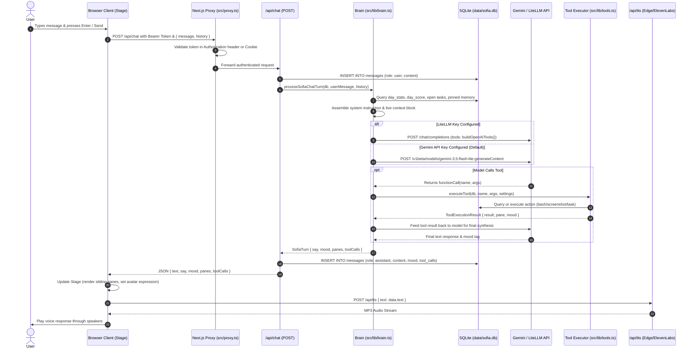
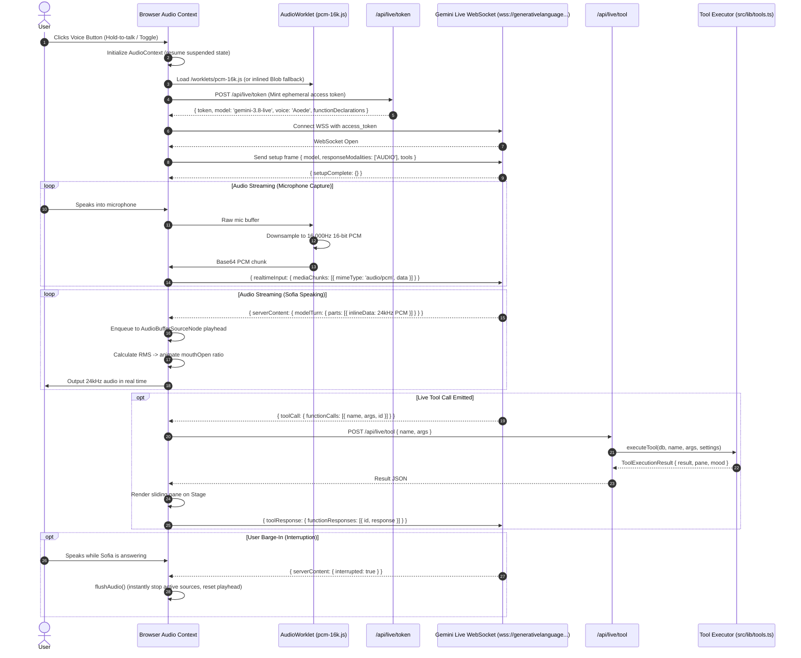

# Phase 0 — Data Flow & Request Lifecycles

## 1. Text Interaction Lifecycle (Pipeline A)



---

## 2. Gemini Live WebSocket Lifecycle (Pipeline B)



---

## 3. Telemetry Ingestion & Scoring Lifecycle

```
[Agent PC / ActivityWatch / OS Window]
       │
       │ HTTP POST (X-Device-Token) every 60s
       ▼
[/api/ingest/events]
       │
       ▼
[SQLite: events table]
       │
       │ Nightly Cron / Periodic Worker (scripts/rollup.ts or /api/cron/evening_verdict)
       ▼
[lib/scoring.ts -> calculateDayScore()]
       ├── Work min vs Leisure min ratio
       ├── Commit count from GitHub API
       ├── Focus blocks & distraction count
       └── Telemetry coverage ratio
       │
       ▼
[SQLite: day_stats & day_scores tables]
       │
       ▼
[Surfaced to Stage Live Debug & Brain Prompt Context]
```
