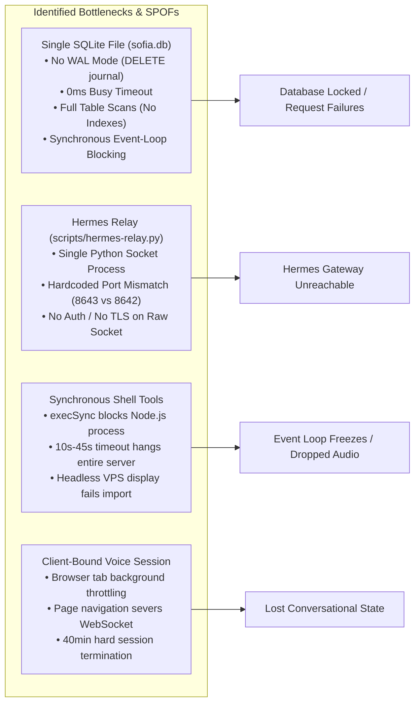
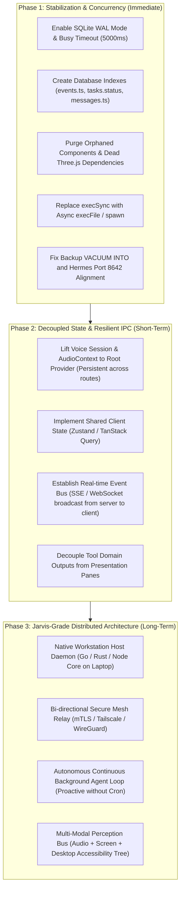

# FULL-SYSTEM ENGINEERING AUDIT: ARCHITECTURAL REPORT (AGENT 1)

**Target System**: Sofia Personal AI Companion ("agitated-archimedes")  
**Role**: Principal System Architect (Agent 1)  
**Standard**: Non-Negotiable Audit Principles (Evidence Over Assumptions, Actual Implementation Verified, Complete Execution Paths Traced)  
**Deliverable Destination**: `audit/06-agent-reports/architecture.md`  

---

## 1. Architectural Overview & Component Inventory

### 1.1 Executive System Overview
Sofia is architected as a hybrid personal AI companion system combining:
1. **Next.js 16 (App Router / React 19 / Turbopack)**: Web application server serving a luxury burgundy dark glass UI, Server-Sent Events (SSE), and REST API endpoints.
2. **Local Persistence Engine (`node:sqlite`)**: Single-file SQLite database (`data/sofia.db`) accessed synchronously via Node 22's experimental `node:sqlite.DatabaseSync`.
3. **Dual Conversational Intelligence**:
   - **Gemini Live Bidirectional Audio**: Browser client connects directly via WebSocket (`wss://generativelanguage.googleapis.com/...`) using ephemeral tokens minted by `/api/live/token`.
   - **LiteLLM / Gemini Flash Chat Turn Engine**: Server-side fallback (`src/lib/brain.ts`) executing multi-turn tool calling across OpenAI-compatible or Google Generative Language APIs.
4. **Machine Execution & CUA Layer**: Tools delegating OS control, shell commands, and CUA driver actions either directly via local `child_process.execSync` or over an HTTP bridge (`LAPTOP_HERMES_URL` / `HERMES_BRIDGE_URL`) mediated by `scripts/hermes-relay.py`.
5. **Background Sensing**: Daemon scripts (`agent-pc/agent.py` and `scripts/agent-pc.py`) polling Linux window management tools (`xdotool`, `xprop`) or ActivityWatch (`localhost:5600`) and pushing telemetry to `/api/ingest/events` and `/api/ingest/heartbeat`.

```mermaid
flowchart TD
    subgraph Client ["Browser Client (React 19 / Next.js)"]
        UI["Stage / Avatar / Panes (src/app/page.tsx)"]
        ChatUI["Chat Console (src/app/chat/page.tsx)"]
        LiveSession["SofiaLiveSession (src/lib/live/session.ts)"]
        AudioWorklet["PCM-16k Worklet (public/worklets/pcm-16k.js)"]
    end

    subgraph GoogleCloud ["Google Cloud API"]
        GeminiLiveWS["Gemini Live Bidi WebSocket (v1beta)"]
        GeminiREST["Gemini 3.5 Flash Lite REST API"]
    end

    subgraph NextServer ["Next.js Server Runtime (Node.js 22)"]
        Proxy["Proxy Filter (src/proxy.ts)"]
        AuthMiddleware["verifyApiAuth (src/lib/auth.ts)"]
        
        subgraph APIRoutes ["API Routes (src/app/api)"]
        TokenRoute["/api/live/token"]
        ToolRoute["/api/live/tool"]
        ChatRoute["/api/chat"]
        IngestRoute["/api/ingest/events & heartbeat"]
        CronRoute["/api/cron/[job]"]
        TTSRoute["/api/tts"]
        StreamRoute["/api/stream"]
        end

        subgraph CoreEngine ["Core Logic (src/lib)"]
        Brain["Brain Turn Engine (src/lib/brain.ts)"]
        ToolEngine["Tool Dispatch (src/lib/tools.ts)"]
        PolicyEngine["Policy Guardrails (src/lib/policy.ts)"]
        ScoringEngine["Scoring Engine (src/lib/scoring.ts)"]
        ProactiveEngine["Proactive Engine (src/lib/proactive.ts)"]
        ActionEngine["Named Actions (src/lib/actions)"]
        end

        DBAccess["DatabaseSync (src/lib/db.ts)"]
    end

    subgraph Storage ["Local Storage"]
        SQLiteDB[("data/sofia.db (node:sqlite)")]
        AudioCache[("data/audio/*.mp3")]
    end

    subgraph HostSystem ["Host / Workstation OS (Linux)"]
        ShellExec["execSync (child_process)"]
        HermesRelay["scripts/hermes-relay.py (Port 8644 -> 8643)"]
        HermesAgent["Hermes Agent (Port 8642 / 8643)"]
        DesktopX11["X11 / Wayland Desktop (xdotool / import)"]
        Watcher["agent-pc.py / ActivityWatch"]
    end

    %% Client Connections
    LiveSession <-->|"Bidi PCM Audio / VAD"| GeminiLiveWS
    LiveSession -->|"POST /api/live/tool"| ToolRoute
    LiveSession -->|"POST /api/live/token"| TokenRoute
    UI -->|"POST /api/chat"| ChatRoute
    UI -->|"GET /api/stream (SSE)"| StreamRoute
    Watcher -->|"POST /api/ingest/*"| IngestRoute

    %% Server Internal
    TokenRoute --> GoogleCloud
    ChatRoute --> Brain
    Brain --> ToolEngine
    ToolRoute --> ToolEngine
    ToolEngine --> DBAccess
    ToolEngine --> PolicyEngine
    ToolEngine --> ActionEngine
    ToolEngine --> ShellExec
    ToolEngine -.->|"HTTP Bridge"| HermesRelay
    HermesRelay --> HermesAgent
    DBAccess --> SQLiteDB
    IngestRoute --> DBAccess
    CronRoute --> ProactiveEngine
    ProactiveEngine --> DBAccess
    TTSRoute --> AudioCache
```



---

### 1.2 Comprehensive Component Inventory

| Component Category | File Path | Primary Responsibility | Critical Dependencies |
| :--- | :--- | :--- | :--- |
| **Routing / Proxy** | `src/proxy.ts` | Next.js 16 incoming request interceptor; enforces bearer token auth on API and redirects browser sessions to `/unlock` | `src/lib/auth.ts`, `next/server` |
| **Auth System** | `src/lib/auth.ts` | Bearer token, custom header (`x-sofia-token`), device token (`x-device-token`), cron secret (`x-cron-secret`), and cookie validation | `next/server` |
| **Database Access** | `src/lib/db.ts` | SQLite schema initialization, default rule/task seeding, day stats rebuilding, score calculation | `node:sqlite (DatabaseSync)`, `src/lib/scoring.ts` |
| **Brain / LLM Engine** | `src/lib/brain.ts` | Context assembly, prompt generation, LiteLLM & Gemini Flash API integration, function calling loop | `src/lib/persona.ts`, `src/lib/db.ts`, `src/lib/tools.ts`, `src/lib/stage.ts` |
| **Tool Dispatch** | `src/lib/tools.ts` | Definition and execution of 22 unified tools across SQLite, OS shell, filesystem, Stage pane generation, and Hermes relay | `src/lib/db.ts`, `src/lib/actions`, `child_process`, `fs`, `src/lib/hermes-tools.ts` |
| **Hermes Tool Definitions** | `src/lib/hermes-tools.ts` | Tool parameter schemas for computer control (`computer_screenshot`, `computer_click`, `computer_run`), schedules, and skills | None |
| **Live Voice Session** | `src/lib/live/session.ts` | Browser Web Audio API context, AudioWorklet microphone capture (16kHz PCM), WebSocket protocol handling, client-side VAD barge-in | Web Audio API, WebSocket, AudioWorklet |
| **Live Voice Config** | `src/lib/live/config.ts` | Server-side Gemini Live session setup configuration, voice personality injection, and tool declarations | `src/lib/persona.voice.ts`, `src/lib/tools.ts` |
| **Scoring Engine** | `src/lib/scoring.ts` | Deterministic mathematical scoring across wake, focus, output, leisure, and sleep components | `src/lib/types.ts` |
| **Consequence Policy** | `src/lib/policy.ts` | Strict multi-gate safety ladder enforcement (kill switch, quiet hours, hard ceiling, daily cap, cooldowns) | `src/lib/types.ts` |
| **Proactivity Engine** | `src/lib/proactive.ts` | Guardrail checks (quiet hours, daily cap, min gap) and schedule handlers (`wake_report`, `midday_check`, `daily_verdict`) | `src/lib/db.ts`, `src/lib/github.ts` |
| **Speech / TTS** | `src/lib/tts.ts` | Edge TTS synthesis, ElevenLabs API integration, monthly character budget quota tracker, disk cache pruning | `msedge-tts`, `node:sqlite`, `crypto`, `fs` |
| **Client Voice Playback** | `src/lib/voice.ts` | Browser-side audio element playback, AudioContext unlocking, speech queue cancellation, Web Speech API fallback | Web Audio API, Web Speech API |
| **Named Actions** | `src/lib/actions/index.ts` | Allowlisted administrative action runner (`backup-sofia-db`, `system-status`, `git-status`, etc.) | `src/lib/actions/*` |
| **Stage Core** | `src/components/Stage.tsx` | Dynamic holographic companion layout, responsive avatar scaling, dual captions, and pane rail anchor | `src/components/SofiaAvatar.tsx`, `src/components/PaneRail.tsx` |
| **Avatar Component** | `src/components/SofiaAvatar.tsx` | 2D PNG/WebP expression renderer with audio-reactive mouth overlay and orbital frequency rings | `src/lib/expressions.ts` |
| **Telemetry Collector** | `agent-pc/agent.py` | Linux active window tracker using `xdotool` and `xprop`; pushes events and heartbeats to port 3000 | `subprocess`, `urllib.request` |
| **Hermes Bridge Relay** | `scripts/hermes-relay.py` | TCP socket forwarder between container bridge (`10.0.1.1:8644`) and local host Hermes gateway (`127.0.0.1:8643`) | `socket`, `select`, `threading` |

---

## 2. Component Boundaries & Coupling Analysis

### 2.1 Server-Client Boundary Blurring (Backend Generating UI Panes)
- **Violation Location**: `src/lib/tools.ts` (lines 349–359, 401–412, 420–427, 441–452, 467–476, 547–554, 571–580, 626–633, 655–661, 675–682, 707–714, 726–735, 750–759, 768–775, 828–836) and `src/lib/brain.ts` (lines 349–360, 372–382, 404–413, 463–471, 473–481).
- **Actual Behavior**: The backend tool execution layer does not return pure structured domain data. Instead, it tightly couples with the frontend presentation layer by synthesizing React `Pane` UI models containing layout metadata (`kind: 'stat' | 'chart' | 'timeline' | 'todo' | 'code' | 'web' | 'image'`), display titles, styling directives, and visual formatting.
- **Expected Architecture**: Backend tools should return normalized domain entity data (e.g. `{ stats: DayStats, score: DayScore }`). The client-side Stage component or an intermediary presentation adapter should determine how and when to project this data into visual widgets.
- **Architectural Risk**: Any change to frontend component contracts requires modifying backend tool execution files. The backend cannot be cleanly exposed as a headless CLI, mobile API, or external MCP service without shipping bloated, frontend-specific JSON payloads.

### 2.2 Execution Target Ambiguity (Container vs. Workstation Split)
- **Violation Location**: `src/lib/tools.ts` lines 643–740 and `src/lib/actions/git-status.ts` lines 5–7.
- **Actual Behavior**:
  - `computer_screenshot` (line 646): Executes `execSync("DISPLAY=:0 import -window root ...")`.
  - `computer_run` (line 671): Executes `execSync(args.command)`.
  - `computer_file_read` (line 700): Executes `fs.readFileSync(args.path)`.
  - `computer_file_write` (line 723): Executes `fs.writeFileSync(args.path, args.content)`.
  - `git-status.ts` (lines 5–7): Executes `execSync("git rev-parse ...")`.
- **Expected Architecture**: In a production deployment (Coolify container on a VPS per `README.md` lines 11–13), Next.js executes inside an isolated Linux container (`node:22-alpine` per `Dockerfile`). The target of "computer use" is supposed to be the user's workstation. 
- **Reality**: These tools execute on the **container host itself**, reading container files and running container shell commands. They do NOT execute on the user's laptop unless Next.js happens to be run locally in dev mode. Only tools routed through `delegateToHermes` (lines 802–845) reach the external machine, creating an erratic split where `computer_run` runs on the VPS but `computer_click` attempts to reach the laptop.

### 2.3 Redundant Tool Execution Engines
- **Violation Location**: `src/lib/brain.ts` lines 174–488 vs. `src/lib/tools.ts` lines 21–800.
- **Actual Behavior**: `src/lib/brain.ts` declares `SOFIA_TOOLS` (lines 174–333) and an entire tool execution function `executeSofiaTool` (lines 335–488). However, `processSofiaBrainTurn` (lines 587, 677) actually imports and executes `executeTool` from `src/lib/tools.ts`. `executeSofiaTool` and `SOFIA_TOOLS` are 100% duplicate, dead code that diverged from the canonical tool set.

---

## 3. State & Concurrency Model

### 3.1 Single-Process SQLite Concurrency & Missing Pragmas
- **Evidence File**: `src/lib/db.ts` lines 25–33, 36–176.
- **Implementation Reality**:
  ```ts
  // src/lib/db.ts:25-33
  let _db: DatabaseSync | null = null;
  export function getDatabase(): DatabaseSync {
    if (!_db) {
      _db = new DatabaseSync(DB_PATH);
      initDatabase(_db);
    }
    return _db;
  }
  ```
- **Critical Defects**:
  1. **Zero WAL Mode Configuration**: The database initialization contains no `PRAGMA journal_mode = WAL;`. By default, SQLite operates in `DELETE` rollback journal mode. In this mode, any write transaction locks the entire database file exclusively, blocking all read operations.
  2. **Zero Busy Timeout Configuration**: There is no `PRAGMA busy_timeout = 5000;`. SQLite's default busy timeout is `0ms`. If two concurrent requests attempt to access the database (e.g., an incoming event ingestion on `/api/ingest/events` and an SSE heartbeat read on `/api/stream`), the second operation immediately throws `SqliteError: database is locked` rather than waiting for lock release.
  3. **Blocking Synchronous I/O on Event Loop**: `DatabaseSync` executes all queries synchronously. In `rebuildDayStats` (`src/lib/db.ts` lines 434–546), the engine performs multi-table scans, JSON parsing, and memory sorting across the entire day's events. Because Node.js is single-threaded, this synchronous execution freezes the main event loop, introducing latency spikes in real-time audio streams.
  4. **Redundant Synchronous Rebuilds**: In `ingestEvents` (`src/lib/db.ts` line 428), `rebuildDayStats` is invoked for every ingested date. Immediately thereafter, `src/app/api/ingest/events/route.ts` line 21 calls `rebuildDayStats(db, today)` a second time, duplicating full table scans on every 60-second telemetry push.
  5. **Unindexed Table Scans**: `initDatabase` creates 14 tables without creating a single index (`CREATE INDEX`). Lookups on `events WHERE ts LIKE '2026-11-07%'` (`src/lib/db.ts` line 438) and `tasks WHERE status = 'completed'` perform unindexed full table scans that degrade linearly as telemetry accumulates.

### 3.2 Dual Database Split-Brain (Laptop vs. VPS)
- **Actual Behavior**: The system architecture provides no data synchronization protocol (no Litestream, no Turso replication, no CRDTs, no logical replication).
- **Execution Path**:
  - If Next.js runs on Coolify (`sofia.ctum.org`), `data/sofia.db` resides in a Docker container volume on the VPS.
  - If `agent-pc/agent.py` runs on the laptop, line 15 hardcodes `SERVER_URL = "http://127.0.0.1:3000"`. Unless a local Next.js instance is running on port 3000, all heartbeats and events fail silently.
  - If `scripts/agent-pc.py` is configured with `SOFIA_HOST=https://sofia.ctum.org`, it posts events to the VPS database. However, any local developer tools, local scripts (`scripts/rollup.ts`), or local inspections operate on the laptop's separate, empty `data/sofia.db`.

### 3.3 Client-Side React State Fragmentation
- **Evidence Files**: `src/app/page.tsx` (lines 34–67), `src/app/chat/page.tsx` (lines 20–26), `src/app/layout.tsx` (lines 21–45).
- **Defects**:
  1. **Complete Absence of Global State Provider**: `src/app/layout.tsx` defines no React Context, Zustand store, or SWR/Query provider.
  2. **Page-Unmount Session Severance**: All WebSocket connections (`SofiaLiveSession`), AudioContext pipelines, microphone streams, and Stage Panes are encapsulated inside `SofiaStageHome` (`src/app/page.tsx`). Navigating to `/chat`, `/tasks`, or `/settings` unmounts `SofiaStageHome`, terminating the active live voice session, dropping the WebSocket, and clearing all projected Stage Panes.
  3. **Disconnected SSE Stream**: `src/app/api/stream/route.ts` implements a 15-second Server-Sent Events push for live stats and scores. However, `src/app/page.tsx` **never connects to this stream**. It fetches stats once on mount (`src/app/page.tsx` lines 98–125) and never updates unless the entire browser tab is reloaded.

### 3.4 WebSocket Architecture & Tool Execution Ping-Pong
- **Evidence File**: `src/lib/live/session.ts` lines 234–418.
- **Execution Flow**:
  1. Browser connects directly to Google Gemini Live WebSocket via client-side `WebSocket` (line 241).
  2. When the Gemini model issues a tool call, Gemini sends the invocation down the WebSocket to the user's browser (lines 362–364).
  3. The browser receives the tool call and issues an HTTP POST to `/api/live/tool` on the Next.js server (lines 380–384).
  4. The Next.js server executes `executeTool` (`src/lib/tools.ts`), which queries SQLite or invokes `execSync` / Hermes.
  5. The Next.js server returns HTTP JSON to the browser.
  6. The browser formats a `toolResponse` and pushes it back up the WebSocket to Google (lines 409–417).
- **Latency & Reliability Penalty**: This architecture introduces an inefficient 4-leg network ping-pong (`Google -> Browser -> Next Server -> Browser -> Google`) for every tool call. If the browser tab throttles background timers or if network connectivity fluctuates between client and server, the tool call hangs and Gemini times out.

---

## 4. Identified Bottlenecks & Single Points of Failure



### 4.1 Synchronous `execSync` Freezing Server Event Loop
- **File**: `src/lib/tools.ts` line 671; `src/lib/actions/git-status.ts` lines 5–7.
- **Finding**: Execution of external commands uses synchronous `execSync` with timeouts up to 10,000ms. If an external command hangs or takes 5 seconds to complete, the single-threaded Node.js server cannot serve any other concurrent HTTP requests, health checks, or live tool calls.

### 4.2 Hermes Relay Port Mismatch & Brittle Socket Forwarding
- **File**: `scripts/hermes-relay.py` lines 13–14 vs. `src/lib/tools.ts` line 803 vs. `README.md` line 27.
- **Finding**:
  - `README.md` line 27 specifies Hermes API runs on `http://127.0.0.1:8642/v1`.
  - `src/lib/tools.ts` line 803 configures default fallback to `http://127.0.0.1:8642/v1`.
  - However, `scripts/hermes-relay.py` line 14 binds target to `("127.0.0.1", 8643)`.
  - Unless an undocumented secondary proxy maps 8643 to 8642, any traffic relayed over the bridge connects to a closed port and fails with connection refused.

### 4.3 Unsafe Database File Copy Under Live Transactions
- **File**: `src/lib/actions/backup-sofia-db.ts` line 19.
- **Finding**: The backup action performs `fs.copyFileSync(sourceDb, destDb)`. Performing a direct filesystem copy of an active SQLite database while write transactions may be occurring can produce a corrupted, unusable backup. SQLite provides the Online Backup API or `VACUUM INTO 'backup.db'` specifically to guarantee transactionally consistent point-in-time snapshots (which `scripts/backup.sh` correctly uses via `sqlite3 .backup`, but the web-triggered action does not).

---

## 5. Architectural Technical Debt & Gaps

### 5.1 Missing Advertised Pages & Phantom Capabilities
1. **Missing `/computer-use` Page**:
   - `README.md` lines 33 and 43 state: `| /computer-use | **Computer Use** | Hermes background computer use hub: CUA driver status, toolsets overview, quick system audits, and interactive execution console. |`
   - **Verification**: `find src/app/computer-use` returns `No such file or directory`. `grep -rn "computer-use" src/` returns zero hits. The page was completely omitted from the codebase.
2. **Ghost 3D Digital Human Dependencies**:
   - `package.json` lines 12, 13, 19 install `@pixiv/three-vrm` (^3.5.5), `@types/three` (^0.187.0), and `three` (^0.187.0).
   - `README.md` lines 5, 16–21 and reports advertise Sofia as a 3D digital human with FACS-based expressions.
   - **Verification**: `grep -rn "three" src/` shows zero usage. `SofiaAvatar.tsx` renders static 2D WebP images (`/public/sofia/expressions/*.webp`) inside an `` tag with a CSS-animated `<div>` for the mouth. The 3D engine is dead weight inflating dependency installation and container image size.

### 5.2 Orphaned Code Inventory
The following files exist in the source repository but are never imported or referenced:
1. `src/components/CaptionLine.tsx` (100% orphaned).
2. `src/components/CategoryBars.tsx` (100% orphaned).
3. `src/components/ScoreRing.tsx` (100% orphaned).
4. `src/components/SofiaPanel.tsx` (100% orphaned).
5. `src/hooks/useVoiceInput.ts` (293 lines orphaned; replaced by `SofiaLiveSession`).
6. `src/app/audition/page.tsx` (368 lines internal voice test bench left in production routing).
7. `src/lib/brain.ts` lines 174–488 (`SOFIA_TOOLS` and `executeSofiaTool`; replaced by `src/lib/tools.ts`).

### 5.3 Simulated / Mocked Production Actions
The action handlers in `src/lib/actions/` represent critical Jarvis integrations, but three out of six are hardcoded simulations:
1. `src/lib/actions/restart-sofia.ts` (lines 1–7): Returns a hardcoded static string without signaling systemd or Docker.
2. `src/lib/actions/sync-obsidian-vault.ts` (lines 1–19): Returns a static mock string `"142 notes in sync with local storage."`.
3. `src/lib/actions/tail-wazuh-alerts.ts` (lines 1–29): Returns a hardcoded array of 3 synthetic log alerts.

---

## 6. Recommendations for Jarvis-Grade Architecture Evolution

To transition Sofia from a fragile prototype to an authentic, resilient, enterprise-grade JARVIS-level assistant, the system architecture must evolve across three distinct phases:



### Phase 1: Immediate Stabilization & Concurrency Hardening
1. **Enable SQLite WAL Mode and Busy Timeout**:
   - In `src/lib/db.ts`, execute immediately after database opening:
     ```sql
     PRAGMA journal_mode = WAL;
     PRAGMA busy_timeout = 5000;
     PRAGMA synchronous = NORMAL;
     ```
2. **Add Missing Database Indexes**:
   - Add schema migration:
     ```sql
     CREATE INDEX IF NOT EXISTS idx_events_ts ON events(ts);
     CREATE INDEX IF NOT EXISTS idx_events_category ON events(category);
     CREATE INDEX IF NOT EXISTS idx_tasks_status ON tasks(status);
     CREATE INDEX IF NOT EXISTS idx_messages_ts ON messages(ts);
     ```
3. **Purge Dead Weight and Align Ports**:
   - Remove unused dependencies: `pnpm remove three @types/three @pixiv/three-vrm`.
   - Delete orphaned files: `CaptionLine.tsx`, `CategoryBars.tsx`, `ScoreRing.tsx`, `SofiaPanel.tsx`, `useVoiceInput.ts`.
   - Align `scripts/hermes-relay.py` target port to `8642` matching Hermes default.
   - Refactor `backup-sofia-db.ts` to use `VACUUM INTO ?` instead of `copyFileSync`.

### Phase 2: Decoupled State & Global Presence
1. **Root-Level Session Persistence**:
   - Move `SofiaLiveSession`, `AudioContext`, and microphone streaming from `src/app/page.tsx` into a `SofiaPresenceProvider` in `src/app/layout.tsx`.
   - Allow seamless navigation across `/chat`, `/tasks`, `/timeline`, and `/settings` while maintaining unbroken, bidirectional live voice conversation.
2. **Pure Data Tool Responses**:
   - Refactor `src/lib/tools.ts` to return domain data only. Implement a client-side Stage projection dispatcher that converts data models into UI panes dynamically.
3. **Active Telemetry Subscription**:
   - Connect client UI to `/api/stream` using an event listener hook so score rings, activity classification, and tasks update reactively without requiring manual browser refreshes.

### Phase 3: Autonomous Distributed Jarvis Engine
1. **True Workstation Node (Host Agent)**:
   - Deploy a dedicated, lightweight daemon directly on the user's laptop.
   - The daemon hosts the CUA driver, desktop event tap, and terminal execution, exposing a secure mTLS/gRPC interface to the VPS brain.
2. **Autonomous Proactive Agent Loop**:
   - Replace external HTTP cron triggers with an in-process temporal workflow scheduler.
   - Implement an autonomous perception loop that monitors focus drifts, system events, and task deadlines in real-time, intervening proactively with high contextual relevance.
