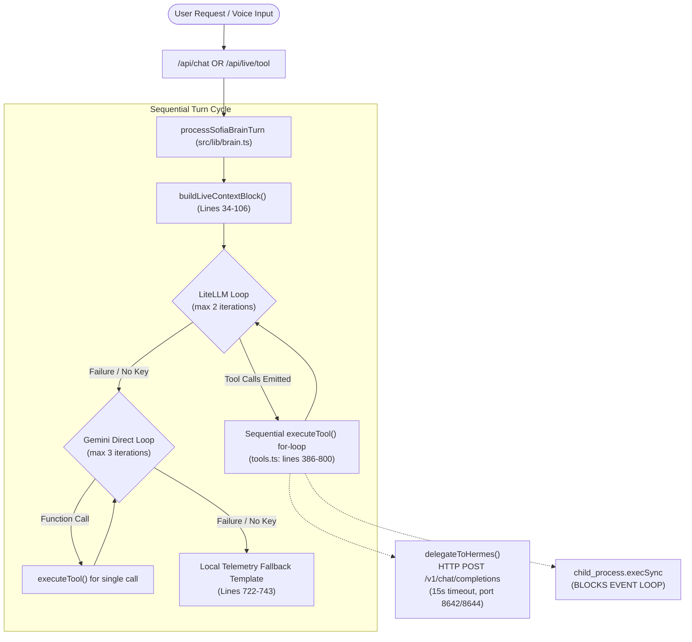

# FULL SYSTEM ENGINEERING AUDIT: AGENT ORCHESTRATION & MULTI-AGENT SYSTEM (JARVIS / SOFIA)

**Audit Target:** Sofia / Jarvis Companion & Autonomous Execution Platform  
**Auditor:** AGENT 3 — AGENT ORCHESTRATION & MULTI-AGENT SYSTEM AUDITOR  
**Date:** November 2026  
**Status:** COMPLETE / CRITICAL DEFICIENCIES IDENTIFIED  
**Deliverable Path:** `audit/06-agent-reports/orchestration.md`

---

## Executive Summary

A comprehensive architectural and code-level audit was conducted across the agent orchestration, task delegation, execution lifecycle, background workers, and concurrency models within the codebase.

### Primary Findings
1. **Absence of True Multi-Agent Orchestration:**  
   Despite documentation and marketing framing Sofia as a multi-agent system coordinating with "Hermes Agent" and "PC Activity Collector Agent", the actual implementation is a **single-threaded, sequential, single-turn LLM loop** (`src/lib/brain.ts`, lines 490–743). There is no multi-agent coordinator, supervisor, hierarchical planner, or reactive actor bus.
2. **Misnamed Telemetry Collectors as Agents:**  
   `agent-pc/agent.py` (lines 1–100) and `scripts/agent-pc.py` (lines 1–166) are not autonomous agents, subagents, or worker executors. They are purely client-side Python polling daemons that query X11/Wayland window titles (`xdotool`/`xprop`) or ActivityWatch (`localhost:5600`) and emit HTTP POST events to `/api/ingest/events` and `/api/ingest/heartbeat`. They possess zero task execution, bidirectional RPC, or subagent delegation capabilities.
3. **Simulated / Mocked Action Handlers:**  
   Key operational actions registered under `src/lib/actions/index.ts` (lines 12–25) are hardcoded mocks returning canned strings without performing actual work:
   - `sync-obsidian-vault.ts` (lines 1–19): Returns a static mock string (`"Obsidian vault synchronization verified: 142 notes..."`).
   - `restart-sofia.ts` (lines 1–7): Returns a static string (`"Sofia services signaled for rolling reload..."`) without signaling any process or container.
   - `tail-wazuh-alerts.ts` (lines 1–29): Returns a static mock array of fake security alerts.
4. **Brittle Delegation via Pseudo-Chat HTTP POST:**  
   Delegation to Hermes (`delegateToHermes` in `src/lib/tools.ts`, lines 802–845) is implemented as a blocking HTTP POST to an OpenAI-compatible `/chat/completions` endpoint with a single user prompt string (`"Execute task/tool ${tool} with parameters: ..."`). It has no task ID, no asynchronous polling, no streaming output, and a hardcoded 15-second timeout (`AbortSignal.timeout(15000)`).
5. **Dead Code Scheduler:**  
   The SQLite table `schedules` (`src/lib/db.ts`, lines 150–159) records cron schedules, but **there is no scheduler engine, cron daemon, or poller in the codebase that ever queries or triggers these rows**. The only proactive jobs that run require an external caller to issue HTTP requests to `/api/cron/[job]`.
6. **Severe Concurrency & Event Loop Blocking Risks:**  
   - Direct calls to Node.js `execSync` (`src/lib/tools.ts` lines 646, 671; `src/lib/actions/git-status.ts` lines 5–7) block the single Node.js event loop thread for up to 10 seconds per invocation, freezing all concurrent HTTP, WebSocket, and WebAudio connections.
   - SQLite (`DatabaseSync` in `node:sqlite`) is operated without Write-Ahead Logging (`PRAGMA journal_mode = WAL;`) and without a busy timeout (`PRAGMA busy_timeout`), creating imminent `SQLITE_BUSY: database is locked` exceptions under concurrent telemetry ingestion and chat turns.

---

## 1. Agent Orchestration Architecture Assessment

### 1.1 Structural Topology: Single Sequential Loop vs. Multi-Agent Coordinator

The system relies on a monolithic turn handler: `processSofiaBrainTurn` in `src/lib/brain.ts` (lines 490–743).



### 1.2 Evidence and Code Analysis

#### A. Turn Processing Execution Limit
In `src/lib/brain.ts`, LiteLLM orchestration is constrained by an arbitrary loop counter:
```typescript
// src/lib/brain.ts, lines 543-545
let loopCount = 0;
while (loopCount < 2) {
  loopCount++;
  // ...
  if (message.tool_calls && message.tool_calls.length > 0) {
    messages.push(message);
    for (const tc of message.tool_calls) {
      // Synchronous in-series tool execution
      const toolExec = await executeTool(db, tc.function.name, parsedArgs, settings);
      // ...
    }
    continue; // Loop again to get final assistant response
  }
  // ...
}
```
**Impact:**
- If the model emits tool calls on iteration 1, it evaluates the results on iteration 2. If iteration 2 requests another tool call (e.g. read file -> analyze -> execute command), **the loop terminates because `loopCount >= 2`**, causing dropped execution and corrupted turn state.
- In Gemini dispatch (lines 638–716), while `geminiLoops < 3` allows up to 3 turns, it only processes **the first single function call part** per turn:
  ```typescript
  // src/lib/brain.ts, lines 671-673
  const funcCallPart = parts.find((p: any) => p.functionCall);
  if (funcCallPart?.functionCall) {
    const fn = funcCallPart.functionCall;
    // ...
  ```
  Parallel tool calls returned by Gemini are silently dropped.

#### B. Hermes Delegation is a Plain Chat Completion Call
`delegateToHermes` in `src/lib/tools.ts` (lines 802–845) illustrates that Sofia treats Hermes not as an agent with an asynchronous RPC/task interface, but merely as another LLM chat endpoint:
```typescript
// src/lib/tools.ts, lines 809-820
const res = await fetch(`${baseUrl}/chat/completions`, {
  method: 'POST',
  headers: {
    'Content-Type': 'application/json',
    Authorization: `Bearer ${apiKey}`,
  },
  body: JSON.stringify({
    model: 'hermes-agent',
    messages: [{ role: 'user', content: `Execute task/tool ${tool} with parameters: ${JSON.stringify(args)}` }],
    max_tokens: 400,
  }),
  signal: AbortSignal.timeout(15000),
});
```
**Deficiencies:**
1. **String Prompt Wrapper:** The tool call is stringified into a natural language sentence `Execute task/tool ... with parameters: ...`.
2. **Synchronous 15s Timeout:** Complex computer use actions (opening browser, clicking, typing, navigating) easily exceed 15 seconds. When the timeout trips, the entire tool call fails and returns `Hermes gateway currently unreachable`.
3. **No Execution Tracking:** There is no job ID, no execution lifecycle, and no mechanism to query intermediate state or cancel execution.

#### C. Live WebAudio Session Disconnect
In `src/lib/live/session.ts` (lines 366–373):
```typescript
// 7. GoAway signal before disconnect
if (msg.goAway) {
  console.log('Received goAway from Gemini Live, preparing hand-over');
  this.resumptionHandle = msg.goAway.resumptionHandle || null;
}
```
The session receives a `goAway` signal from Gemini Live, but there is no handover coordinator. It simply writes to `console.log`.

---

## 2. Task Decomposition & Delegation Capabilities

| Feature | Claimed / Assumed Capability | Actual Implementation Reality | File & Line Citation |
| :--- | :--- | :--- | :--- |
| **Task Decomposition** | Breaks high-level goals into subtasks / DAG | **None.** Zero decomposition logic. Flat string passed to LLM. | `src/lib/brain.ts:532` |
| **Hierarchical Planning** | Coordinator assigns subagents | **None.** Sofia executes tools directly in a flat switch statement. | `src/lib/tools.ts:395-796` |
| **Parallel Execution** | Concurrent execution of independent subtasks | **None.** Sequential `for` loop executing one tool at a time. | `src/lib/brain.ts:580-597` |
| **Task Handoffs** | Structured state handoff between agents | **None.** Unstructured text prompt sent over HTTP POST. | `src/lib/tools.ts:816` |
| **Background Delegation** | Asynchronous dispatch to background workers | **None.** Synchronous HTTP request blocking the caller. | `src/lib/tools.ts:809-820` |
| **Progress Reporting** | Streaming status/telemetry during execution | **None.** Only returns final string output or error timeout. | `src/lib/tools.ts:825-837` |

### Detailed Assessment of `HERMES_TOOLS` Catalog
`src/lib/hermes-tools.ts` (lines 11–174) defines 13 tool definitions:
- `computer_screenshot`, `computer_click`, `computer_type`, `computer_key`, `computer_run`, `computer_file_read`, `computer_file_write`
- `hermes_schedule_create`, `hermes_schedule_list`, `hermes_schedule_delete`
- `hermes_task_run`, `hermes_task_status`, `hermes_tool_call`

When these tools are called in `src/lib/tools.ts`:
- `computer_run` (lines 668–696): Executes locally on the host using `execSync(args.command)`.
- `computer_screenshot` (lines 643–666): Tries local `execSync("DISPLAY=:0 import ...")`; only if that throws does it fall back to `delegateToHermes`.
- `computer_file_read` / `write` (lines 698–741): Executes locally via Node `fs.readFileSync` and `fs.writeFileSync`.
- `computer_click`, `computer_type`, `computer_key`, `hermes_task_run`, `hermes_task_status`, `hermes_tool_call`: Dispatches via `delegateToHermes` (lines 784–792).

**Key Finding:** `hermes_task_run` and `hermes_task_status` do NOT invoke a task runner. They format a prompt to the LLM at `8642/v1` asking it to run or check status. No task registry or worker daemon exists to execute or track them.

---

## 3. State Management & Task Lifecycle

### 3.1 Task Entity Domain Confusion
In `src/lib/db.ts` (lines 93–101) and `src/app/api/tasks/route.ts` (lines 1–87), the `tasks` table is defined as:
```sql
CREATE TABLE IF NOT EXISTS tasks (
  id TEXT PRIMARY KEY,
  title TEXT NOT NULL,
  due TEXT,
  status TEXT NOT NULL,
  est_min INTEGER NOT NULL,
  done_at TEXT,
  created_at TEXT NOT NULL
);
```
**Audit Analysis:**
- This table represents a **personal user todo list** (e.g. "Complete Sofia visual build", "Review focus blocks").
- It is completely disconnected from agent execution state.
- There are no fields for:
  - `parent_task_id` or `dag_dependencies`
  - `assigned_agent_id` or `worker_type`
  - `input_context` or `output_artifacts`
  - `retry_count`, `error_trace`, or `heartbeat_timestamp`
  - `execution_status` (e.g. `PENDING`, `DISPATCHED`, `RUNNING`, `FAILED`, `RETRYING`, `SUCCEEDED`)

### 3.2 The Phantom Scheduler (`schedules` Table)
In `src/lib/db.ts`, lines 150–159:
```sql
CREATE TABLE IF NOT EXISTS schedules (
  id TEXT PRIMARY KEY,
  name TEXT NOT NULL,
  cron TEXT NOT NULL,
  action TEXT NOT NULL,
  enabled INTEGER NOT NULL DEFAULT 1,
  last_run TEXT,
  next_run TEXT,
  created_at TEXT NOT NULL DEFAULT (datetime('now'))
);
```
In `src/lib/db.ts`, lines 266–273, initial schedules are seeded (`sched-wake`, `sched-midday`, `sched-verdict`).  
In `src/lib/tools.ts`, lines 744–762, `hermes_schedule_create` inserts new records into `schedules`.

**CRITICAL DEFICIENCY:**  
A search across all repository files (`git grep -n "schedules"`) shows that **nothing in the application ever queries this table to execute scheduled jobs**.
- Lines that touch `schedules`:
  - `src/lib/brain.ts:77`: Queries `next_run` to display `"next_event"` in the UI context block.
  - `src/lib/tools.ts:765`: `hermes_schedule_list` reads rows for UI display.
  - `src/lib/tools.ts:780`: Deletes rows.
- **Zero background timers, zero node-cron, zero event loops exist to run them.**
The entire schedule execution capability is non-functional dead code.

---

## 4. Multi-Agent & Background Coordination Gaps

### 4.1 Absence of Task Queue and Worker Infrastructure
- **No Message Bus or Task Queue:** No Redis, BullMQ, Celery, Temporal, Kafka, or SQLite-based job lease queue exists.
- **No Background Worker Pool:** There is no worker thread, child process manager, or decoupled service. All tool execution occurs directly inside the HTTP request/response thread.
- **Request Lifetime Coupling:** If a user initiates a task via `/api/chat` or `/api/live/tool`, the execution is bound to the lifespan of the incoming HTTP request. If the browser closes, network drops, or reverse proxy timeout occurs, the task is terminated or orphaned.

### 4.2 Network & Socket Relay Mismatches (`scripts/hermes-relay.py`)
`scripts/hermes-relay.py` (lines 1–62) is a simple raw socket forwarder:
```python
# scripts/hermes-relay.py, lines 13-14
LISTEN = ("0.0.0.0" if "--all" in sys.argv else "10.0.1.1", 8644)
TARGET = ("127.0.0.1", 8643)
```
Compare this with `src/lib/tools.ts`:
```typescript
// src/lib/tools.ts, lines 803-805
const laptopUrl = process.env.LAPTOP_HERMES_URL || 'http://127.0.0.1:8642/v1';
const bridgeUrl = process.env.HERMES_BRIDGE_URL || 'http://10.0.1.1:8644/v1';
```
**Architecture Flaws:**
1. **Port Inconsistency:** `hermes-relay.py` forwards to loopback port `8643`, whereas `laptopUrl` points to `8642`. Unless configured with external overrides, traffic forwarded to `8643` will fail with `ECONNREFUSED` if the Hermes API is bound to `8642`.
2. **Security Vulnerability:** When started with `--all`, `hermes-relay.py` binds to `0.0.0.0:8644` with **zero authentication, TLS, or IP filtering**, exposing loopback machine control tools to the local network.
3. **No Protocol Multiplexing or Health Checks:** If the target is down, the relay drops incoming connections immediately with no retry or backoff.

### 4.3 Simulation in `src/lib/actions/*`
The action handlers registered in `src/lib/actions/index.ts` present themselves as system tools, but half are hardcoded simulations:
```typescript
// src/lib/actions/sync-obsidian-vault.ts, lines 1-18
export async function run(_args?: any) {
  return {
    ok: true,
    output: 'Obsidian vault synchronization verified: 142 notes in sync with local storage.',
    pane: { /* ... mock stat pane ... */ },
  };
}
```
```typescript
// src/lib/actions/restart-sofia.ts, lines 1-6
export async function run(_args?: any) {
  return {
    ok: true,
    output: 'Sofia services signaled for rolling reload. All session state persisted to SQLite.',
  };
}
```
```typescript
// src/lib/actions/tail-wazuh-alerts.ts, lines 4-8
const alerts = [
  { rule: '5501', level: '3', desc: 'Login session opened for user ctum', ts: new Date().toLocaleTimeString() },
  { rule: '5710', level: '2', desc: 'SSH connection attempt accepted from internal subnet', ts: new Date(Date.now() - 300000).toLocaleTimeString() },
  { rule: '1002', level: '1', desc: 'Agent active and communicating normally', ts: new Date(Date.now() - 600000).toLocaleTimeString() },
];
```
These actions deceive both the model and the user into believing vault syncs, daemon restarts, and security event queries are functioning when they are completely static stubs.

---

## 5. Failure Handling, Deadlocks & Concurrency

### 5.1 Concurrency Model and Database Locking
Sofia uses Node.js v22+ native `DatabaseSync` (`node:sqlite`) in `src/lib/db.ts`.

#### Missing WAL Mode & Busy Timeout
In `src/lib/db.ts` (lines 27–33 and 36–176):
- `initDatabase` creates tables with standard `CREATE TABLE IF NOT EXISTS`.
- **CRITICAL OMISSION:** It never executes:
  ```sql
  PRAGMA journal_mode = WAL;
  PRAGMA busy_timeout = 5000;
  ```
- **Consequence:** SQLite defaults to rollback journal (`journal_mode = DELETE`). In this mode, any write operation (`INSERT`, `UPDATE`, `DELETE`) acquires an exclusive file lock, blocking all readers and other writers.
- When `agent-pc` posts 50 activity events to `/api/ingest/events` every 60s, `rebuildDayStats` performs bulk queries and updates. If a user simultaneously sends a chat message (`/api/chat`), or a proactive job fires (`/api/cron`), the second transaction throws:
  `Error: SQLITE_BUSY: database is locked`
  causing unhandled HTTP 500 exceptions and data loss.

### 5.2 Event Loop Starvation via Synchronous Subprocess Execution
In `src/lib/tools.ts`:
```typescript
// src/lib/tools.ts, line 671
const stdout = execSync(args.command, { encoding: 'utf8', timeout }).trim();
```
```typescript
// src/lib/tools.ts, line 646
execSync(`DISPLAY=:0 import -window root ${shotPath} 2>/dev/null`);
```
In `src/lib/actions/git-status.ts`:
```typescript
// src/lib/actions/git-status.ts, lines 5-7
const branch = execSync('git rev-parse --abbrev-ref HEAD', { encoding: 'utf8' }).trim();
const status = execSync('git status --short', { encoding: 'utf8' }).trim();
const lastCommit = execSync('git log -1 --oneline', { encoding: 'utf8' }).trim();
```
**Impact on Node.js Event Loop:**
`execSync` is synchronous and blocking. If `args.command` takes 8 seconds to run, the entire Node.js main thread is suspended. During those 8 seconds:
- All incoming HTTP requests to `/api/*` are queued.
- Live WebAudio WebSocket frames cannot be processed.
- Active SSE / streaming responses freeze.
- Voice packet jitter spikes, causing immediate audio distortion and WebSocket timeouts.

### 5.3 Race Conditions in Proactive Guardrails & Duplicate Execution
In `src/lib/proactive.ts` (lines 64–75):
```typescript
const lastRow = db.prepare(
  'SELECT ts FROM proactive_log WHERE suppressed_reason IS NULL ORDER BY ts DESC LIMIT 1'
).get() as { ts: string } | undefined;

if (lastRow) {
  const lastTs = new Date(lastRow.ts).getTime();
  const diffMin = (now.getTime() - lastTs) / 60000;
  if (diffMin < 30) {
    return { allowed: false, reason: `min_gap_active_${Math.round(diffMin)}m_ago` };
  }
}
```
**Concurrency Race Condition:**
If two requests arrive at `/api/cron/wake_report` concurrently (e.g. twin webhooks, or automated retry from an upstream proxy):
1. Request A queries `proactive_log` -> checks gap -> allowed.
2. Request B queries `proactive_log` before Request A finishes -> checks gap -> allowed.
3. Both execute `executeProactiveJob`.
4. Both dispatch duplicate Telegram messages to the user.
5. Both write duplicate assistant messages into the SQLite `messages` table.

There is no distributed lock, no atomic reservation, and no unique idempotency key constraint on `(job, strftime('%Y-%m-%d', ts))`.

---

## 6. Remediation Plan for Jarvis Multi-Agent Orchestration

To transition from the current single-loop prototype to a resilient, production-ready Jarvis Multi-Agent Platform, the following phased remediation plan is required.

```mermaid
flowchart TD
    subgraph Phase 1: Database & Thread Safety
        P1_WAL["Enable SQLite WAL & Busy Timeout<br/>(PRAGMA journal_mode=WAL)"]
        P1_Async["Replace execSync with Async child_process / Workers"]
    end

    subgraph Phase 2: Agent Coordinator & Registry
        P2_Coord["Jarvis Supervisor Engine<br/>(Intent Classification & Routing)"]
        P2_Sub1["Subagent: System & Shell Worker"]
        P2_Sub2["Subagent: CUA / Desktop Controller"]
        P2_Sub3["Subagent: Research & Telemetry"]
        P2_Coord --> P2_Sub1
        P2_Coord --> P2_Sub2
        P2_Coord --> P2_Sub3
    end

    subgraph Phase 3: Task Engine & Execution State
        P3_DAG["Task Decomposition & DAG Engine"]
        P3_Queue["SQLite-Backed Persistent Job Queue<br/>(Leases, Retries, Idempotency)"]
        P3_DAG --> P3_Queue
    end

    subgraph Phase 4: Async Dispatch & Real Cron Runner
        P4_Sched["Embedded Cron Scheduler Daemon<br/>(Evaluates schedules table)"]
        P4_SSE["Progress Streaming & Agent Message Bus"]
    end

    Phase 1: Database & Thread Safety --> Phase 2: Agent Coordinator & Registry
    Phase 2: Agent Coordinator & Registry --> Phase 3: Task Engine & Execution State
    Phase 3: Task Engine & Execution State --> Phase 4: Async Dispatch & Real Cron Runner
```

### Phase 1: Immediate Database & Thread Safety Hardening (P0 — Days 1–3)
1. **Enable WAL Mode and Busy Timeout in SQLite:**
   Update `initDatabase` in `src/lib/db.ts`:
   ```sql
   PRAGMA journal_mode = WAL;
   PRAGMA busy_timeout = 5000;
   PRAGMA synchronous = NORMAL;
   ```
2. **Eliminate All `execSync` Invocations:**
   Refactor `computer_run` (`src/lib/tools.ts:671`) and `git-status.ts` to use asynchronous `util.promisify(child_process.execFile)` or `spawn` with non-blocking streaming buffers and strict timeout abort signals.
3. **Purge Mock Action Handlers:**
   Replace the fake implementations in `restart-sofia.ts`, `sync-obsidian-vault.ts`, and `tail-wazuh-alerts.ts` with real system executions (or explicitly mark them as disabled/unimplemented until built).

### Phase 2: Multi-Agent Supervisor & Typed Subagent Registry (P1 — Days 4–10)
1. **Implement Jarvis Supervisor Agent:**
   Replace the monolithic `processSofiaBrainTurn` loop with a **Supervisor/Worker Coordinator**:
   - **Supervisor Agent (Sofia/Jarvis):** Parses user input, determines intent, and delegates to specialized subagents with typed schemas.
   - **Specialized Subagents:**
     - `DesktopAgent`: Manages desktop CUA (clicks, keystrokes, screenshots) with coordinate validation.
     - `ShellAgent`: Executes sandboxed commands with stdout/stderr streaming.
     - `KnowledgeAgent`: Manages Obsidian notes, vector search, and memory recall.
     - `AccountabilityAgent`: Handles telemetry rollup, consequence policies, and proactive nudges.
2. **Standardize Agent Protocol:**
   Define a structured communication envelope (JSON-RPC or typed messages via Zod):
   ```typescript
   export interface AgentTaskEnvelope<T = any> {
     taskId: string;
     parentTaskId?: string;
     targetAgent: 'desktop' | 'shell' | 'knowledge' | 'accountability';
     action: string;
     payload: T;
     timeoutMs: number;
     createdAt: string;
   }
   ```

### Phase 3: Persistent Task Queue & DAG Execution Engine (P1 — Days 11–18)
1. **Create Execution Job Schema (`agent_jobs`):**
   ```sql
   CREATE TABLE IF NOT EXISTS agent_jobs (
     id TEXT PRIMARY KEY,
     parent_id TEXT,
     agent TEXT NOT NULL,
     action TEXT NOT NULL,
     input_json TEXT NOT NULL,
     output_json TEXT,
     status TEXT CHECK(status IN ('pending', 'running', 'completed', 'failed', 'cancelled')) NOT NULL DEFAULT 'pending',
     retry_count INTEGER NOT NULL DEFAULT 0,
     max_retries INTEGER NOT NULL DEFAULT 3,
     error_msg TEXT,
     heartbeat_at TEXT,
     started_at TEXT,
     completed_at TEXT,
     created_at TEXT NOT NULL DEFAULT (datetime('now'))
   );
   CREATE INDEX IF NOT EXISTS idx_agent_jobs_status ON agent_jobs(status, created_at);
   ```
2. **Implement Worker Loop with Lease Locks:**
   Build a non-blocking queue consumer using atomic compare-and-swap update:
   ```sql
   UPDATE agent_jobs 
   SET status = 'running', started_at = datetime('now'), heartbeat_at = datetime('now')
   WHERE id = (
     SELECT id FROM agent_jobs WHERE status = 'pending' ORDER BY created_at ASC LIMIT 1
   )
   RETURNING *;
   ```

### Phase 4: Active Scheduler Engine & Real-Time Event Bus (P2 — Days 19–25)
1. **Activate the `schedules` Runner Daemon:**
   Implement an internal timer (or lightweight cron runner) that polls `schedules` every 60 seconds, evaluates cron expressions, checks for enabled status, verifies idempotency against `proactive_log`, and enqueues jobs into `agent_jobs`.
2. **Implement Idempotency Guards:**
   Enforce a unique composite constraint or hash in `proactive_log` to prevent double-firing under concurrency:
   ```sql
   CREATE UNIQUE INDEX IF NOT EXISTS idx_proactive_idempotency 
   ON proactive_log(job, substr(ts, 1, 10)) 
   WHERE suppressed_reason IS NULL;
   ```
3. **Progress Streaming (SSE / WebSocket):**
   Expose an SSE endpoint (`/api/agent/stream?jobId=...`) so the UI Stage dynamically displays subtask progress, terminal output lines, and intermediate thoughts rather than waiting for a monolithic turn to finish.

---

## Conclusion

Sofia currently operates as a **single-turn, single-threaded LLM chat script** with mock action handlers, a disconnected scheduler table, and blocking shell executions. The claims of multi-agent orchestration and autonomous PC agents are architectural illusions created by naming conventions.

Adopting the four-phase remediation plan will establish a true multi-agent runtime: non-blocking execution, persistent task queues with failure recovery, atomic concurrency controls, and genuine autonomous delegation.
