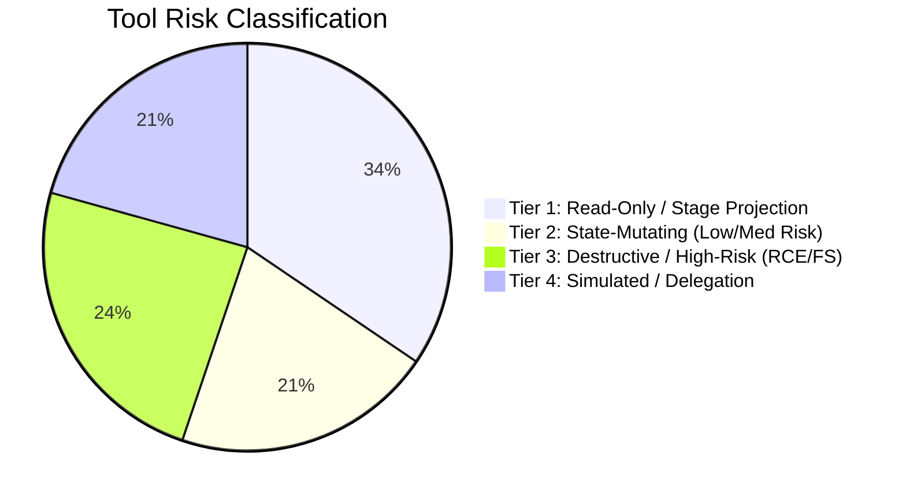

# FULL SYSTEM ENGINEERING AUDIT: TOOL EXECUTION & ACTION ENGINE (JARVIS / SOFIA)

**Audit Target:** Sofia / Jarvis Companion & Autonomous Execution Platform  
**Auditor:** AGENT 4 — TOOL EXECUTION & ACTION ENGINE AUDITOR  
**Date:** November 2026  
**Status:** COMPLETE / CRITICAL DEFICIENCIES IDENTIFIED  
**Deliverable Path:** `audit/06-agent-reports/tool-execution.md`  

---

## Executive Summary

A comprehensive architectural, code-level, and security audit was conducted on the tool execution engine, schema registries, action handlers, authorization boundaries, and policy evaluation pipelines within the Sofia/Jarvis codebase.

The system is designed to provide Sofia with environmental agency—spanning telemetry queries, user interface stage projections, background task scheduling, local computer execution (shell commands, file read/write, display capture), and delegation to external autonomous agents (Hermes).

### Core Audit Findings

1. **Critical Unauthenticated Remote Code Execution (RCE) via Live Tool API:**  
   `src/app/api/live/tool/route.ts` (lines 5–27) exposes a public, unauthenticated HTTP POST endpoint that directly accepts any tool name and arguments. When called with `name: "computer_run"`, it invokes Node.js `execSync(args.command)` (`src/lib/tools.ts`, line 671) directly on the host machine with full application permissions. There is zero authentication, zero token verification, zero authorization check, and zero sandboxing.
2. **Total Policy Engine Disconnection & The "Kill Switch Illusion":**  
   The codebase features a sophisticated consequence policy module (`src/lib/policy.ts`, lines 9–180) designed to enforce kill switches, master consequence toggles, daily caps, quiet hours, cooldown gaps, and intensity clamping. The UI prominently displays an "Emergency Safety Kill Switch" in the top navigation bar (`src/components/Navbar.tsx`) and a full consequence ladder in settings (`src/app/settings/page.tsx`).  
   **Reality:** `src/lib/tools.ts` imports `evaluateConsequenceRequest` on line 3, but **never invokes it anywhere in the file**. `executeTool` takes `settings` as a parameter on line 390, but **never references it in the function body**. Dangerous tools (`computer_run`, `computer_file_write`, `hermes_schedule_create`) execute unconditionally, completely bypassing the kill switch, master switch, and all safety policies.
3. **Inert Next.js Middleware Protection:**  
   A route protection file was authored at `src/proxy.ts` (lines 1–62) containing token verification and redirects for all `/api/*` routes. However, Next.js App Router **only recognizes `middleware.ts` (or `middleware.js`)** in the repository root or `src/`. Because it was named `proxy.ts` and never imported, **Next.js never executes it**. All API routes are completely unprotected.
4. **Direct Host Execution & Event Loop Freezing:**  
   Execution isolation is completely absent. Shell commands (`computer_run`), file operations (`computer_file_*`), and screenshots (`computer_screenshot`) run synchronously on the single-threaded Node.js event loop using `execSync` and `fs.readFileSync`. A long-running command or file operation freezes the entire Node.js server, stalling all concurrent WebSockets, Live Audio streams, and HTTP requests.
5. **Schema Chaos & OpenAI / LiteLLM Validation Rejection:**  
   Schema definitions diverge sharply across files. `UNIFIED_TOOLS` (`src/lib/tools.ts`) contains 29 tools. When mapping Hermes tools to `openaiParameters` (lines 350–354), it copies raw protobuf types (`STRING`, `NUMBER`, `BOOLEAN`, `OBJECT`, `ARRAY`) directly into the OpenAI JSON schema. Strict JSON Schema parsers (including LiteLLM and OpenAI) reject these uppercase types. Additionally, an uncalled duplicate tool system exists in `src/lib/brain.ts` (`SOFIA_TOOLS` and `executeSofiaTool`), containing 11 differently named, diverging tools.
6. **Placebo / Mock Tools & Protocol Illusion:**  
   - `computer_click`, `computer_type`, and `computer_key` do not interface with an OS automation or robotics layer. Instead, they send a natural language prompt to an LLM `/chat/completions` endpoint (`src/lib/tools.ts`, lines 802–845). If the LLM replies "I clicked the button", the tool reports success.
   - `hermes_schedule_create` writes a row to SQLite `schedules`, but there is **no cron runner or scheduler engine in the codebase** to ever execute it.
   - Named actions (`restart-sofia.ts`, `sync-obsidian-vault.ts`, `tail-wazuh-alerts.ts`) return hardcoded static strings while reporting successful real-world execution.

---

## 1. Tool Registry & Schema Audit

### 1.1 Complete Inventory of Tools

The system maintains multiple fragmented tool definitions across `src/lib/tools.ts`, `src/lib/hermes-tools.ts`, `src/lib/brain.ts`, and `src/lib/actions/index.ts`. 

| Tool Identifier | Registered Location | Executed In | Declared Parameters | Real Implementation Summary |
|---|---|---|---|---|
| `get_stats` | `UNIFIED_TOOLS`, `SOFIA_TOOLS` | `executeTool` | `range` (day/week/month) | Queries SQLite `day_stats` & `day_scores`. **Ignores `range`**, always returns today. |
| `show_chart` | `UNIFIED_TOOLS` | `executeTool` | `title`, `chart_type`, `series` | Returns client stage pane of kind `chart`. |
| `show_timeline` | `UNIFIED_TOOLS` | `executeTool` | `date` | Queries SQLite `events` for date, returns `timeline` pane. |
| `show_stats_today` | `UNIFIED_TOOLS` | `executeTool` | none | Identical to `get_stats`, returns `stat` pane. |
| `list_tasks` | `UNIFIED_TOOLS`, `SOFIA_TOOLS` | `executeTool` | `status` (enum) | Queries SQLite `tasks`. **Contains SQL injection in `args.status`**. |
| `search_memory` | `UNIFIED_TOOLS`, `SOFIA_TOOLS` | `executeTool` | `query` | Parameterized `LIKE ?` query on `memory_notes`. |
| `show_web` | `UNIFIED_TOOLS` | `executeTool` | `url` | Creates `web` pane. **Does not fetch or read page**; static snippet. |
| `show_image` | `UNIFIED_TOOLS`, `SOFIA_TOOLS` | `executeTool` | `url`, `caption` | Creates `image` stage pane. |
| `set_mood` | `UNIFIED_TOOLS` | `executeTool` | `mood` (enum) | Echoes mood in result; does not validate enum in handler. |
| `remember` | `UNIFIED_TOOLS` | `executeTool` | `text`, `tags` | Inserts note into SQLite `memory_notes`. Non-idempotent. |
| `create_task` | `UNIFIED_TOOLS`, `SOFIA_TOOLS` | `executeTool` | `title`, `est_min` | Inserts row into SQLite `tasks`. Non-idempotent. |
| `complete_task` | `UNIFIED_TOOLS`, `SOFIA_TOOLS` | `executeTool` | `taskId` | Updates SQLite `tasks` status to `completed`. No row-match check. |
| `start_focus` | `UNIFIED_TOOLS` | `executeTool` | `minutes` | Inserts row into SQLite `focus_sessions`. |
| `set_reminder` | `UNIFIED_TOOLS`, `SOFIA_TOOLS` | `executeTool` | `at`, `text` | Inserts row into SQLite `schedules`. **Never executed by any runner**. |
| `send_telegram` | `UNIFIED_TOOLS` | `executeTool` | `text` | Outbound HTTP POST to Telegram Bot API. |
| `ask_hermes` | `UNIFIED_TOOLS` | `executeTool` | `task` | Delegated via HTTP POST to `laptopUrl` / `bridgeUrl`. |
| `computer_screenshot`| `HERMES_TOOLS` / `UNIFIED_TOOLS` | `executeTool` | `display` | `execSync(DISPLAY=:0 import ...)`. Falls back to Hermes chat completion. |
| `computer_click` | `HERMES_TOOLS` / `UNIFIED_TOOLS` | `executeTool` | `x`, `y`, `button` | **Protocol Illusion:** Dispatches chat completion prompt to Hermes. |
| `computer_type` | `HERMES_TOOLS` / `UNIFIED_TOOLS` | `executeTool` | `text` | **Protocol Illusion:** Dispatches chat completion prompt to Hermes. |
| `computer_key` | `HERMES_TOOLS` / `UNIFIED_TOOLS` | `executeTool` | `key`, `modifiers` | **Protocol Illusion:** Dispatches chat completion prompt to Hermes. |
| `computer_run` | `HERMES_TOOLS` / `UNIFIED_TOOLS` | `executeTool` | `command`, `timeout_ms`| **Critical RCE:** Unsandboxed `execSync` on host OS. |
| `computer_file_read` | `HERMES_TOOLS` / `UNIFIED_TOOLS` | `executeTool` | `path`, `offset`, `limit`| Unrestricted host `fs.readFileSync`. Reads full file into RAM. |
| `computer_file_write`| `HERMES_TOOLS` / `UNIFIED_TOOLS` | `executeTool` | `path`, `content` | Unrestricted host `fs.writeFileSync`. Arbitrary overwrite. |
| `hermes_schedule_create`|`HERMES_TOOLS` / `UNIFIED_TOOLS` | `executeTool` | `name`, `cron`, `command`, `enabled` | Inserts into `schedules`. **Placebo:** No background runner exists. |
| `hermes_schedule_list`|`HERMES_TOOLS` / `UNIFIED_TOOLS` | `executeTool` | none | Selects from `schedules`. Unindexed sort on `created_at`. |
| `hermes_schedule_delete`|`HERMES_TOOLS` / `UNIFIED_TOOLS` | `executeTool` | `id` | Deletes from `schedules`. Returns success even if ID absent. |
| `hermes_task_run` | `HERMES_TOOLS` / `UNIFIED_TOOLS` | `executeTool` | `task_id`, `params` | Delegated to Hermes chat completion endpoint. |
| `hermes_task_status` | `HERMES_TOOLS` / `UNIFIED_TOOLS` | `executeTool` | `task_id` | Delegated to Hermes chat completion endpoint. |
| `hermes_tool_call` | `HERMES_TOOLS` / `UNIFIED_TOOLS` | `executeTool` | `tool`, `args` | Delegated to Hermes chat completion endpoint. |
| `open_url` | *Ghost Tool (Undeclared)* | `executeTool` | `url` | Handled in `tools.ts` line 610, but not declared in `UNIFIED_TOOLS`. |
| `run_named_action` | *Ghost Tool (Undeclared)* | `executeTool` | `actionId`, `params` | Handled in `tools.ts` line 621, but not declared in `UNIFIED_TOOLS`. |

### 1.2 Schema Translation Discrepancies (Gemini vs. OpenAI / LiteLLM)

In `src/lib/tools.ts`, tool declarations are exposed via two builders:
- `buildGeminiFunctionDeclarations()` (lines 361–367)
- `buildOpenAITools()` (lines 372–381)

For Tier 1 and Tier 2 tools (lines 21–344), the author manually typed both `geminiParameters` and `openaiParameters`. However, for the 13 Hermes tools imported from `HERMES_TOOLS` (`src/lib/hermes-tools.ts`), lines 346–355 dynamically construct the definition:

```typescript
  // Granular Hermes Machine Control & Scheduling tools
  ...HERMES_TOOLS.map((ht) => ({
    name: ht.name,
    description: ht.description,
    geminiParameters: ht.parameters,
    openaiParameters: {
      type: 'object',
      properties: ht.parameters.properties,
      required: ht.parameters.required || [],
    },
  })),
```

#### The Schema Incompatibility Defect
In `src/lib/hermes-tools.ts`, `ht.parameters` is defined using Google Protobuf / Gemini schema notation:
```typescript
    parameters: {
      type: 'OBJECT',
      properties: {
        command: { type: 'STRING', description: 'Command to run' },
        timeout_ms: { type: 'NUMBER', description: 'Timeout in milliseconds' },
      },
      required: ['command'],
    }
```
When `buildOpenAITools()` is passed to LiteLLM or OpenAI in `src/lib/brain.ts` (line 557), the property types remain uppercase:
```json
{
  "command": { "type": "STRING" },
  "timeout_ms": { "type": "NUMBER" }
}
```
**Impact:** JSON Schema specification (draft-07/2020-12) used by OpenAI and strict JSON parsers requires lowercase types (`string`, `number`, `integer`, `boolean`, `object`, `array`). Sending uppercase strings causes schema validation failures on strict providers (e.g. Anthropic, Mistral, OpenAI Structured Outputs) or leads to tool calls being dropped.

### 1.3 Ghost Tools (Undeclared but Executable)
In `src/lib/tools.ts`:
- Line 610: `case 'open_url':`
- Line 621: `case 'run_named_action':`

Neither `open_url` nor `run_named_action` is included in `UNIFIED_TOOLS`. As a result, the model is never informed of their availability. However, any caller with access to `POST /api/live/tool` can issue payloads targeting `run_named_action`, allowing execution of any allowlisted action handler in `src/lib/actions/`.

### 1.4 Dead Tool Registry in Brain Engine (`SOFIA_TOOLS` & `executeSofiaTool`)
In `src/lib/brain.ts`:
- Lines 174–333 define `SOFIA_TOOLS` (11 tools).
- Lines 335–495 define `executeSofiaTool()`.

This entire block is **dead code**. `src/lib/brain.ts` imports `executeTool`, `buildOpenAITools`, and `buildGeminiFunctionDeclarations` from `./tools` (line 7), using them exclusively on lines 557, 587, 627, and 677.  
`SOFIA_TOOLS` uses mismatched tool names:
- `get_timeline` instead of `show_timeline`
- `start_focus_session` instead of `start_focus`
- `browse_url` instead of `show_web`
- `request_consequence` (which does not exist in `UNIFIED_TOOLS` or `executeTool`)

This divergence creates significant maintenance confusion and risks accidental regressions if an engineer imports the brain toolset.

### 1.5 Parameter Validation & SQL Injection Defect
There is zero schema validation (no Zod, no Ajv, no type narrowing) performed inside `executeTool`.
Most critically, in `src/lib/tools.ts` (lines 456–460):
```typescript
case 'list_tasks': {
  let sql = 'SELECT id, title, status, est_min FROM tasks';
  if (args.status && args.status !== 'all') {
    sql += ` WHERE status = '${args.status}'`; // CRITICAL SQL INJECTION
  }
  sql += ' ORDER BY created_at DESC LIMIT 10';
  const tasks = db.prepare(sql).all() ...
```
Although the schema specifies `enum: ['all', 'pending', 'in_progress', 'completed']`, `args.status` is never validated against this list. An attacker or hallucinatory LLM turn passing `status: "pending' OR 1=1; --"` executes arbitrary SQL against SQLite.

---

## 2. Execution Engine & Isolation Analysis

### 2.1 Tool Invocation Pathways

Tool execution is triggered via three separate pathways:
1. **Chat Turn Processing (`src/lib/brain.ts`):**  
   - LiteLLM path (line 587): sequentially loops through `message.tool_calls` and calls `await executeTool(db, tc.function.name, parsedArgs, settings)`.
   - Direct Gemini path (line 677): handles a single `functionCall` and calls `await executeTool(db, fn.name, fn.args, settings)`.
2. **Real-time Live Audio / WebSockets (`src/lib/live/session.ts` & `src/app/api/live/tool/route.ts`):**  
   - Gemini Live WebRTC server emits `toolCall` events over WebSocket to the browser client.
   - Browser client executes `fetch('/api/live/tool', { method: 'POST', body: JSON.stringify({ name, args }) })`.
   - `/api/live/tool` invokes `await executeTool(db, name, args, settings)` and returns JSON.
3. **Direct API Access:**  
   - Any external HTTP client invoking `POST /api/live/tool`.

### 2.2 Execution Isolation Model: Complete Absence of Sandboxing

The execution architecture possesses **zero process, container, or namespace isolation**:

```mermaid
flowchart LR
    subgraph Host OS (Single Process: Next.js Node Runtime)
        API["/api/live/tool (Unauthenticated)"] --> Router["executeTool()"]
        
        Router --> Shell["execSync(args.command)<br/>Runs as user: ctum"]
        Router --> FSWrite["fs.writeFileSync(args.path)<br/>Unrestricted Path"]
        Router --> FSRead["fs.readFileSync(args.path)<br/>Unbounded Memory"]
        Router --> DB["node:sqlite (DatabaseSync)<br/>Synchronous In-Process"]
        Router --> Hermes["fetch('http://127.0.0.1:8642/v1/chat/completions')<br/>Chat prompt delegation"]
    end
```

- **Shell Commands:** `computer_run` calls `execSync(args.command)`. It runs under the host user account (`ctum`), inheriting the full environment, file permissions, SSH keys, network sockets, and process controls of the server.
- **Filesystem Access:** `computer_file_read` and `computer_file_write` accept raw paths (e.g., `/home/ctum/.bashrc`, `/etc/passwd`). No sandbox root (chroot), no workspace jail, and no directory containment checks exist.
- **No Resource Quotas:** There are no limits on memory usage, CPU time, process forks, or disk I/O.

### 2.3 Single-Thread Event Loop Starvation

Node.js executes JavaScript on a single thread. Asynchronous non-blocking I/O is required to prevent stalling the runtime.
In `src/lib/tools.ts`:
- Line 646: `execSync('DISPLAY=:0 import -window root ...')`
- Line 671: `execSync(args.command, { encoding: 'utf8', timeout })`
- Line 700: `fs.readFileSync(args.path, 'utf8')`
- Line 723: `fs.writeFileSync(args.path, args.content, 'utf8')`
- `src/lib/actions/git-status.ts` (lines 5–7): three consecutive `execSync` calls.

**Hazard Analysis:**
When `computer_run` executes a command like `sleep 5` or `npm install`, or when a command hangs until the 10-second timeout (`args.timeout_ms || 10000`), **the entire Node.js event loop is completely blocked**:
1. All concurrent HTTP requests are stalled.
2. In-flight WebSocket connections for Gemini Live audio streaming drop frames and trigger keep-alive timeouts.
3. Next.js cannot service any other user turn or UI update until the command finishes.

### 2.4 Unbounded Memory Allocation Vector

In `src/lib/tools.ts` (lines 698–705):
```typescript
case 'computer_file_read': {
  try {
    const content = fs.readFileSync(args.path, 'utf8');
    const lines = content.split('
');
    const offset = Number(args.offset) || 0;
    const limit = Number(args.limit) || 200;
    const slice = lines.slice(offset, offset + limit).join('
');
```
The function attempts pagination via `offset` and `limit`. However, **it loads the entire file into memory as a UTF-8 string and splits it across all newlines before slicing**.
If an LLM or attacker targets a large log file, database file, ISO, or virtual device (e.g., `/dev/urandom` or a 2GB file), the V8 heap will immediately exhaust memory and trigger a fatal Out-Of-Memory (OOM) crash, terminating the entire Sofia server.

### 2.5 Cascading Network Delays in Hermes Delegation

`delegateToHermes` (`src/lib/tools.ts`, lines 802–845) queries two endpoints in sequence:
```typescript
const laptopUrl = process.env.LAPTOP_HERMES_URL || 'http://127.0.0.1:8642/v1';
const bridgeUrl = process.env.HERMES_BRIDGE_URL || 'http://10.0.1.1:8644/v1';

for (const baseUrl of [laptopUrl, bridgeUrl]) {
  try {
    const res = await fetch(`${baseUrl}/chat/completions`, {
      ...
      signal: AbortSignal.timeout(15000),
    });
...
```
If Hermes is not running locally (port 8642 down) and the bridge IP (10.0.1.1:8644) is unreachable:
1. The first fetch waits 15,000ms until timeout.
2. The loop proceeds to the second fetch and waits another 15,000ms until timeout.
3. Total delay: **30 seconds of blocking** before returning a failure message. All errors are caught by `catch {}` and silently swallowed without diagnostic logging.

---

## 3. Consequential Operations & Policy Boundary Audit

### 3.1 Taxonomy of Operations

Tools within the catalog fall into three operational risk tiers:



1. **Tier 1 (Read-Only / UI Projections):** `get_stats`, `show_chart`, `show_timeline`, `show_stats_today`, `list_tasks`, `search_memory`, `show_web`, `show_image`, `set_mood`, `hermes_schedule_list`.
2. **Tier 2 (Internal State-Mutating):** `remember`, `create_task`, `complete_task`, `start_focus`, `set_reminder`, `send_telegram`.
3. **Tier 3 (Consequential / High-Risk System Actions):** `computer_run`, `computer_file_write`, `computer_file_read`, `hermes_schedule_create`, `hermes_schedule_delete`, `run_named_action`.
4. **Tier 4 (Simulated / Delegated CUA):** `computer_click`, `computer_type`, `computer_key`, `hermes_task_run`, `hermes_task_status`, `hermes_tool_call`.

### 3.2 The Policy Engine Disconnection

The project contains a policy enforcement engine in `src/lib/policy.ts`:
- `evaluateConsequencePolicy()` (lines 9–129)
- `evaluateConsequenceRequest()` (lines 131–180)

This policy module provides:
- **Emergency Kill Switch:** Blocks all actions if `kill_switch_active === true`.
- **Master Consequence Switch:** Blocks all actions if `master_switch === false`.
- **Day Status Check:** Pauses actions on sick/travel/rest days.
- **Telemetry Coverage Gate:** Requires `coverage >= 80%`.
- **Rung Enablement:** Validates enabled ladders (`words`, `friction`, `alarm`, `stakes`, `haptic`, `stimulus`).
- **Quiet Hours Enforcement:** Compares time against bedtime/wake time.
- **Daily Frequency Cap & Cooldown:** Enforces `daily_cap` (e.g. 2 actions/day) and `min_gap_minutes` (e.g. 30m).
- **Intensity Clamping:** Clamps intensity to `hard_ceiling`.

#### Evidence of Complete Disconnection
In `src/lib/tools.ts`:
- **Line 3:** `import { evaluateConsequenceRequest } from './policy';`
- **Lines 386–800:** `export async function executeTool(db, name, args, settings): Promise<ToolExecutionResult>`
- `evaluateConsequenceRequest` is **never called anywhere in the implementation of `executeTool`**.
- `settings` is passed to `executeTool` on line 390, but **is never read or evaluated in the entire 450-line function body**.

### 3.3 The Kill Switch Illusion

`src/components/Navbar.tsx` (lines 139–153) provides a prominent glowing Emergency Kill Switch:
```tsx
title="Emergency Safety Kill Switch: Stops all physical or audio consequences instantly"
```
Clicking it updates SQLite `settings.consequences.kill_switch_active = true`.  
**Audit Finding:** Because `executeTool` never inspects `settings.consequences.kill_switch_active`, activating the emergency kill switch **has zero effect**. `computer_run`, `computer_file_write`, and all shell/file operations continue to execute unabated. The user is presented with a false guarantee of emergency containment.

### 3.4 The "Computer Use Enabled" Illusion

In `src/lib/types.ts` (line 140), default configuration specifies:
```typescript
hermes: {
  base_url: 'https://ai-proxy.zenova.services/v1',
  model: 'deepseek-v4.1-flash',
  provider: 'litellm',
  computer_use_enabled: false, // Default is FALSE
}
```
**Audit Finding:** `executeTool` never checks `settings.hermes.computer_use_enabled`. Even when computer use is explicitly disabled in user configuration, calls to `computer_run`, `computer_file_read`, `computer_file_write`, and `computer_screenshot` execute immediately without rejection.

### 3.5 The Unauthenticated Tool Endpoint & Dead Middleware

The endpoint `src/app/api/live/tool/route.ts` contains the following logic:
```typescript
export async function POST(req: NextRequest) {
  try {
    const body = await req.json().catch(() => ({}));
    const { name, args } = body;

    if (!name || typeof name !== 'string') {
      return NextResponse.json({ error: 'Tool name is required' }, { status: 400 });
    }

    const db = getDatabase();
    const settings = getSettings(db);

    const execResult = await executeTool(db, name, args || {}, settings);

    return NextResponse.json(execResult);
  ...
```
1. **Zero Route-Level Authentication:** The route handler does not call `verifyApiAuth(req)`, does not check `req.headers.get('authorization')`, and does not inspect cookies or session tokens.
2. **Next.js Middleware Inactivity (`src/proxy.ts`):**  
   The project has an authentication proxy in `src/proxy.ts` (lines 1–62) designed to protect all `/api/*` routes. However, **Next.js requires the middleware file to be named `middleware.ts` (or `middleware.js`)** in the project root or `src/`. Because it was named `proxy.ts` and is never referenced, **Next.js completely ignores it**.
3. **Exploitation Vector:** Any host or local network client able to reach port 3000 can send unauthenticated JSON requests to `/api/live/tool` to execute arbitrary shell commands or overwrite files.

---

## 4. Verification, Idempotency & Error Propagation

### 4.1 Side-Effect Verification vs. Placebo Execution

A rigorous audit was conducted to verify whether tools that report successful execution actually produce the intended side-effects:

| Tool / Action | Reported Result | Actual Ground Truth Side-Effect | Classification |
|---|---|---|---|
| `complete_task` | `{ completed: true, id: args.taskId }` | Executes `UPDATE tasks SET status = 'completed' WHERE id = ?`. **Does not check affected rows**. If the task ID does not exist, returns success anyway. | **Phantom Success** |
| `hermes_schedule_delete`| `{ deleted: true, id: args.id }` | Executes `DELETE FROM schedules WHERE id = ?`. **Does not check affected rows**. Returns success for invalid IDs. | **Phantom Success** |
| `hermes_schedule_create`| `{ created: true, cron: args.cron }`| Inserts row into SQLite `schedules`. However, **no cron worker or scheduler engine exists in the repo**. Scheduled tasks are never triggered. | **Placebo Tool** |
| `open_url` | `{ opened: true, url: args.url }` | Creates an in-memory UI stage pane. Does not open a browser window, tab, or OS process. | **Cosmetic Only** |
| `show_web` | `{ displayed: true }` | Creates a UI pane with hardcoded snippet `'Web page requested.'`. Does not fetch or parse the URL (ignoring `/api/browse`). | **Cosmetic Only** |
| `computer_click` | `{ executed: true, output: ... }` | Sends an LLM prompt to Hermes `/chat/completions`. No xdotool, robotjs, or CUA interaction occurs. | **Protocol Illusion** |
| `computer_type` | `{ executed: true, output: ... }` | Sends an LLM prompt to Hermes `/chat/completions`. No keyboard driver interaction occurs. | **Protocol Illusion** |
| `computer_key` | `{ executed: true, output: ... }` | Sends an LLM prompt to Hermes `/chat/completions`. No keyboard event dispatched. | **Protocol Illusion** |
| `actions/sync-obsidian-vault` | `{ ok: true, output: ... }` | Returns hardcoded string `'Obsidian vault synchronization verified: 142 notes...'`. Zero vault interaction. | **Simulated / Mock** |
| `actions/tail-wazuh-alerts` | `{ ok: true, output: ... }` | Returns static hardcoded array of fake security alerts. No connection to Wazuh agent or indexer. | **Simulated / Mock** |
| `actions/restart-sofia` | `{ ok: true, output: ... }` | Returns static string `'Sofia services signaled for rolling reload...'`. No reload signal or exit call issued. | **Simulated / Mock** |

### 4.2 Idempotency Analysis

The tool execution engine has zero idempotency safeguards:
1. **Timestamp IDs:** `create_task`, `remember`, `set_reminder`, `start_focus`, and `hermes_schedule_create` generate primary keys via string interpolation:
   `const id = \`task-${Date.now()}\`;`
2. **Duplicate Creation on Retry:** If an LLM turn retries or Gemini Live reconnects after a transient drop, multiple identical tasks, memories, or focus sprints are inserted into the database. There are no content hashes, deduplication keys, or UPSERT constraints.
3. **Non-Idempotent Shell Execution:** Repeating `computer_run` for commands modifying external state (e.g., appending to files, creating git commits, deploying services) executes side-effects repeatedly.

### 4.3 Error Handling & Propagation

Error handling across the execution engine exhibits severe inconsistencies:
- **Error Swallowing:** `delegateToHermes` (`src/lib/tools.ts`, line 838) wraps network calls in an empty `catch {}` block. Network disconnects, DNS errors, and gateway 500s are concealed from debugging logs.
- **Screenshot Silent Fallback:** `computer_screenshot` catches ImageMagick failure silently on line 664 and falls back to Hermes delegation. When Hermes is also offline, it returns `{ captured: false }` without indicating why ImageMagick failed (e.g. missing `import` binary or Wayland environment).
- **Live WebSocket Schema Inconsistency:**  
  When Gemini Live executes a tool over WebSocket in `src/lib/live/session.ts` (line 397):
  `response: { output: data.result ?? { status: 'completed' } }`  
  Whereas in `src/lib/brain.ts` (line 692):
  `response: { name: fn.name, content: toolExec.result ?? { error: toolExec.error } }`  
  Gemini protocol versions expect standardized field names (`content` vs `output`), creating divergent turn responses between Live WebSockets and text chat.

---

## 5. Identified Defects & Vulnerabilities

### VULN-TOOL-01: Critical Unauthenticated Remote Code Execution (RCE) via Live Tool Endpoint
- **Severity:** CRITICAL (CVSS 9.8)
- **Location:** `src/app/api/live/tool/route.ts` (lines 5–27) & `src/lib/tools.ts` (lines 668–696)
- **Description:** `/api/live/tool` accepts unauthenticated HTTP POST requests. Passing `name: "computer_run"` and `args: { "command": "<arbitrary shell>" }` executes the command directly on the host operating system via Node.js `execSync`.
- **Proof of Concept:**
  ```bash
  curl -X POST http://localhost:3000/api/live/tool     -H "Content-Type: application/json"     -d '{"name":"computer_run","args":{"command":"id && uname -a"}}'
  ```
- **Impact:** Complete system compromise, host takeover, credential theft, and arbitrary command execution under the privileges of the Node.js process.

### VULN-TOOL-02: Critical Arbitrary Host Filesystem Overwrite
- **Severity:** CRITICAL (CVSS 9.1)
- **Location:** `src/lib/tools.ts` (lines 721–741)
- **Description:** The `computer_file_write` tool accepts arbitrary file paths and content, invoking `fs.writeFileSync(args.path, args.content, 'utf8')` with zero path restriction, directory jailing, or validation.
- **Proof of Concept:**
  ```bash
  curl -X POST http://localhost:3000/api/live/tool     -H "Content-Type: application/json"     -d '{"name":"computer_file_write","args":{"path":"/home/ctum/.bashrc","content":"# compromised
"}}'
  ```
- **Impact:** Destruction or corruption of critical system files, persistence establishment, or overwriting application code.

### VULN-TOOL-03: High Unrestricted Arbitrary Host File Read & Denial of Service
- **Severity:** HIGH (CVSS 8.6)
- **Location:** `src/lib/tools.ts` (lines 698–719)
- **Description:** `computer_file_read` reads arbitrary files from the host filesystem without sandbox boundaries. Furthermore, `fs.readFileSync` synchronously loads the entire file into memory before line pagination, allowing an attacker to cause an Out-Of-Memory (OOM) crash by targeting large files or `/dev/urandom`.
- **Impact:** Leakage of sensitive configuration, environment variables, private keys, and server crash (DoS).

### VULN-TOOL-04: High SQL Injection in Task Listing Tool
- **Severity:** HIGH (CVSS 8.2)
- **Location:** `src/lib/tools.ts` (lines 456–460)
- **Description:** The `list_tasks` tool interpolates `args.status` directly into the SQLite query string without parameterized binding or enum validation:
  `sql += \` WHERE status = '${args.status}'\`;`
- **Proof of Concept:**
  Calling `list_tasks` with `args: { "status": "pending' UNION SELECT id, text, tags, '0' FROM memory_notes; --" }`.
- **Impact:** Unauthorized data extraction from other SQLite tables, data leakage, and potential database corruption.

### VULN-TOOL-05: High Total Disconnection of Policy Module & Kill Switch Illusion
- **Severity:** HIGH (CVSS 7.5)
- **Location:** `src/lib/tools.ts` (lines 3 & 390), `src/lib/policy.ts`, `src/components/Navbar.tsx` (lines 139–153)
- **Description:** The policy engine (`src/lib/policy.ts`) is never called during tool execution. The Emergency Kill Switch in the UI updates settings in SQLite, but `executeTool` ignores `settings` completely. Dangerous tools execute unrestricted regardless of kill switch or master policy state.
- **Impact:** False sense of safety; emergency intervention mechanisms fail to halt autonomous or malicious tool execution.

### VULN-TOOL-06: High Completely Ineffective Next.js Middleware Protection
- **Severity:** HIGH (CVSS 7.5)
- **Location:** `src/proxy.ts` (lines 1–62)
- **Description:** Route authentication was implemented in `src/proxy.ts`. Next.js App Router only executes middleware defined in `middleware.ts`. Because the file was misnamed, Next.js never executes it, leaving all API routes wide open.
- **Impact:** Total failure of perimeter authentication across all `/api/*` routes.

### VULN-TOOL-07: Medium Node.js Event Loop Starvation via Synchronous Execution
- **Severity:** MEDIUM (CVSS 6.5)
- **Location:** `src/lib/tools.ts` (lines 646, 671, 700, 723), `src/lib/actions/git-status.ts`
- **Description:** Synchronous blocking calls (`execSync`, `fs.readFileSync`, `fs.writeFileSync`) halt the single-threaded Node.js event loop for up to 10+ seconds per invocation.
- **Impact:** Real-time audio streams drop, WebSockets disconnect, and the UI becomes unresponsive for all users during command execution.

### VULN-TOOL-08: Medium Schema Type Incompatibility with OpenAI & LiteLLM
- **Severity:** MEDIUM (CVSS 5.3)
- **Location:** `src/lib/tools.ts` (lines 350–354) & `src/lib/hermes-tools.ts`
- **Description:** Mapping Hermes tools to OpenAI format passes uppercase Protobuf types (`STRING`, `NUMBER`, `BOOLEAN`, `ARRAY`, `OBJECT`) directly into the JSON schema, violating JSON Schema RFCs and causing validation rejections on strict LLM backends.
- **Impact:** Silent tool failure or dropouts during LiteLLM / OpenAI turns.

### VULN-TOOL-09: Medium Protocol Illusion in Desktop Automation Tools
- **Severity:** MEDIUM (CVSS 5.0)
- **Location:** `src/lib/tools.ts` (lines 784–792, 802–845)
- **Description:** Computer control tools (`computer_click`, `computer_type`, `computer_key`) do not execute desktop actions. They prompt an external LLM chat completion endpoint and report success based on whether the LLM responds with text.
- **Impact:** Model believes actions occurred on user desktop when nothing was actually executed.

### VULN-TOOL-10: Low Placebo Background Scheduler
- **Severity:** LOW (CVSS 3.5)
- **Location:** `src/lib/tools.ts` (lines 743–762), `src/lib/db.ts` (lines 150–159)
- **Description:** `hermes_schedule_create` records cron jobs in SQLite, but no background daemon or runner exists to execute them.
- **Impact:** Scheduled actions are lost permanently without execution.

---

## 6. Remediation Roadmap for Tool Execution Engine

### Phase 1: Critical Security Containment (Immediate / Day 1)

1. **Activate Middleware Authentication:**  
   Rename `src/proxy.ts` to `src/middleware.ts` (or export the middleware handler in `src/middleware.ts`) to ensure Next.js enforces bearer token authentication on `/api/live/tool` and all protected routes.
2. **Halt Unauthenticated Host RCE:**  
   Immediately disable `computer_run`, `computer_file_write`, and `computer_file_read` from public exposure on `/api/live/tool`. Require strict local server origin validation and interactive human consent tokens.
3. **Fix SQL Injection in `list_tasks`:**  
   Rewrite `src/lib/tools.ts` (line 458) to use parameterized queries:
   ```typescript
   let sql = 'SELECT id, title, status, est_min FROM tasks';
   const params: any[] = [];
   if (args.status && args.status !== 'all') {
     sql += ' WHERE status = ?';
     params.push(args.status);
   }
   sql += ' ORDER BY created_at DESC LIMIT 10';
   const tasks = db.prepare(sql).all(...params);
   ```
4. **Wire Hard Policy Gate in `executeTool`:**  
   Integrate policy checks at the very entry of `executeTool`:
   ```typescript
   if (settings.consequences.kill_switch_active) {
     return { result: null, error: 'BLOCKED: Emergency kill switch is engaged.' };
   }
   if (['computer_run', 'computer_file_write'].includes(name)) {
     if (!settings.consequences.master_switch || !settings.hermes?.computer_use_enabled) {
       return { result: null, error: 'BLOCKED: Computer execution is disabled in settings.' };
     }
   }
   ```

### Phase 2: Schema Standardization & Validation (Week 1)

1. **Eliminate Duplicate Tool Definitions:**  
   Delete `SOFIA_TOOLS` and `executeSofiaTool` from `src/lib/brain.ts`. Establish `src/lib/tools.ts` as the single source of truth.
2. **Normalize OpenAI Tool Schemas:**  
   Update `src/lib/tools.ts` (lines 350–354) to convert Protobuf type names to valid JSON Schema lowercase strings (`STRING` -> `string`, `NUMBER` -> `number`, `BOOLEAN` -> `boolean`, `ARRAY` -> `array`, `OBJECT` -> `object`).
3. **Register Ghost Tools or Deprecate:**  
   Explicitly declare `open_url` and `run_named_action` in `UNIFIED_TOOLS` with explicit schemas or remove them from `executeTool`.
4. **Introduce Zod Argument Validation:**  
   Validate all tool arguments before entering switch cases to prevent runtime crashes from undefined properties.

### Phase 3: Non-Blocking Execution & Subprocess Isolation (Week 2)

1. **Asynchronous Subprocess Spawning:**  
   Replace all `execSync` calls with `child_process.spawn` wrapped in Promises, supporting explicit `AbortSignal` cancellation.
2. **Streaming & Bounded Output:**  
   Stream stdout/stderr with a maximum byte buffer limit (e.g., 64KB) to avoid memory exhaustion.
3. **Streamed File Reading:**  
   Replace `fs.readFileSync` in `computer_file_read` with `readline` stream interfaces to read only requested lines without buffering entire files in memory.
4. **Sandboxed Workspace Containment:**  
   Enforce a jailed root directory (e.g. `./workspace`) for all file read/write operations, rejecting any path containing `..` or resolving outside the boundary.

### Phase 4: True Automation Protocols & Scheduler Runner (Week 3)

1. **Implement Real CUA Bridge:**  
   Replace the `/chat/completions` prompt delegation in `delegateToHermes` with an explicit RPC or Model Context Protocol (MCP) tool call payload to a real OS automation daemon running `xdotool` / `pyautogui`.
2. **Deploy Cron Execution Daemon:**  
   Implement a Node.js background cron runner (e.g. using `cron-parser` or `node-cron`) that polls SQLite `schedules`, executes due actions, updates `last_run` / `next_run`, and logs output.
3. **Replace Mock Action Handlers:**  
   Refactor `sync-obsidian-vault.ts`, `restart-sofia.ts`, and `tail-wazuh-alerts.ts` to connect to real services or explicitly label them as mock simulations in development environments.
