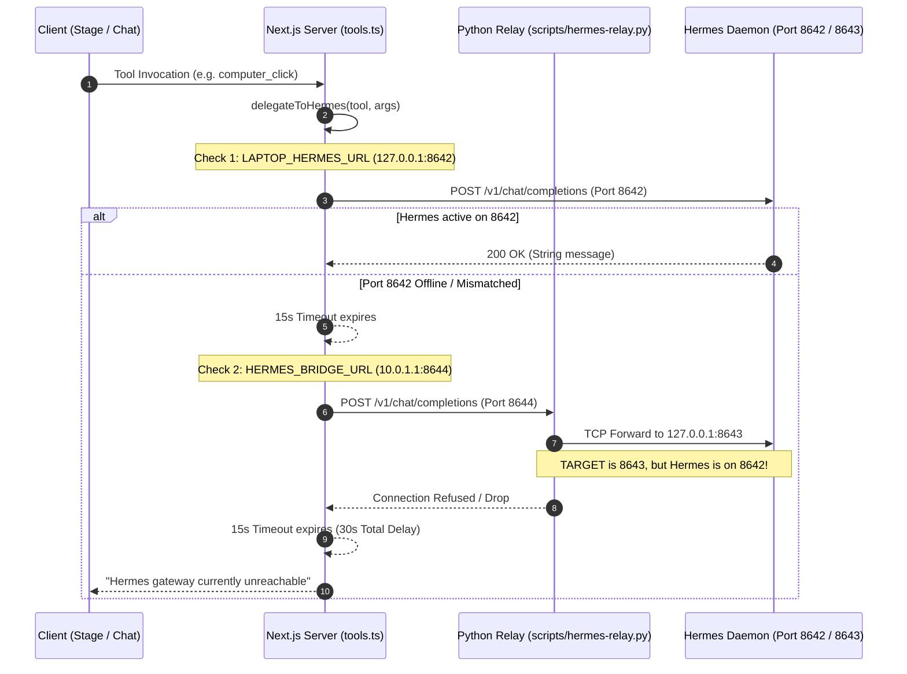
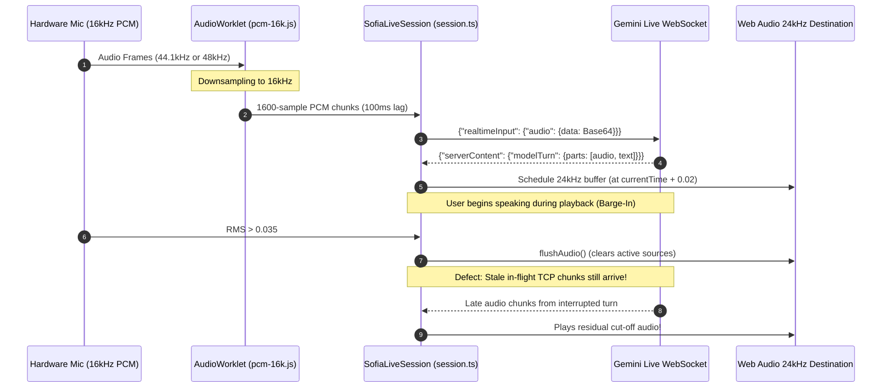

# MASTER AUDIT SYNTHESIS: CROSS-COMPONENT INTEGRATION MATRIX & COMMUNICATION CONTRACTS
**Audit Deliverable**: `audit/07-integration-audit.md`  
**System**: JARVIS / Sofia Platform  
**Date**: November 2026  
**Auditor**: Principal Architecture & Integration Review Board  

---

## 1. Cross-Component Integration Matrix

The following matrix assesses the runtime communication fidelity between every primary component pair in the system.

| Origin Component | Target Component | Protocol / Channel | Payload Schema | Error / Timeout Handling | Actual Integration Status | Critical Failure Mode |
| :--- | :--- | :--- | :--- | :--- | :--- | :--- |
| **Stage UI** (`page.tsx`) | **Chat API** (`/api/chat`) | HTTP POST | `{ message: string }` | Try/Catch, toast error | **Broken / Stateless** | `history` is omitted (`[]`); turns are stateless. |
| **Chat UI** (`chat/page.tsx`) | **Chat API** (`/api/chat`) | HTTP POST | `{ message, history }` | Try/Catch, append UI err | **Degraded** | Slices `history.slice(-6)`; drops tool context. |
| **Live Audio** (`session.ts`) | **Gemini Live WS** | WebSocket (Bidi) | 16kHz PCM Base64 JSON | Hybrid VAD, 1s/2s retry | **Fragile / Failing** | VAD premature cutoff; `gemini-3.8-live` invalid. |
| **Gemini Live WS** | **Live Tool** (`/api/live/tool`)| HTTP POST (Client proxy)| `{ name, args }` | 4-hop round trip | **Unauthenticated RCE** | Bypasses proxy; executes arbitrary `computer_run`. |
| **Chat API** (`route.ts`) | **Brain Engine** (`brain.ts`) | Direct TypeScript call | `(db, userMsg, history)` | 45s LiteLLM + 25s Gemini | **Partially Functional** | 70s worst-case hang; cascades fail silently. |
| **Brain Engine** | **LiteLLM Proxy** | HTTP POST (REST) | OpenAI Chat Completion | 45s AbortSignal | **Functional** | Disabled in local env (`LITELLM_API_KEY=""`). |
| **Brain Engine** | **Gemini REST** | HTTP POST (REST) | Google v1beta JSON | 25s AbortSignal | **BROKEN (404)** | Hardcodes invalid `gemini-3.5-flash-lite`. |
| **Brain Engine** | **Unified Tools** (`tools.ts`)| Direct TypeScript call | `(db, name, args, settings)`| Sequential `for` loop | **Partially Functional** | Mutating tool duplicates across cascade retries. |
| **Unified Tools** | **SQLite DB** (`db.ts`) | Synchronous `node:sqlite`| Prepared statements | **NONE** (0ms busy timeout) | **Concurrency Trap** | Any write collision throws `SQLITE_BUSY`. |
| **Unified Tools** | **Host Shell** | `child_process.execSync` | Bash command string | `timeout: 10000ms` | **CRITICAL EVENT LOOP BLOCK**| Freezes entire Node server for up to 10s. |
| **Unified Tools** | **Hermes Bridge** | HTTP POST (REST) | OpenAI Chat format | 15s AbortSignal (x2) | **BROKEN / MISCONFIGURED** | Relay targets port 8643; code calls 8642. |
| **Agent PC** (`agent.py`) | **Events Ingest** (`/api/ingest/events`)| HTTP POST | JSON array of events | Retries on fail | **Schism / Redundant** | Unauthenticated `agent.py` vs auth `scripts/agent-pc.py`. |
| **Agent PC** (`agent.py`) | **Heartbeat** (`/api/ingest/heartbeat`)| HTTP POST | `{ device, status, ts }`| None | **Insecure** | Plaintext tokens written into `devices.token_hash`. |
| **Cron Route** (`/api/cron/[job]`)| **Proactive Engine** (`proactive.ts`)| Direct TypeScript call | `(db, job, { force })` | Guardrail checks | **Partially Functional** | `proactive_log` channel is `'screen'`; no Telegram push. |
| **Proactive Engine** | **Telegram API** | HTTP POST (REST) | JSON `sendMessage` | **NO TIMEOUT** | **Unreliable** | Unhedged fetch hangs; error responses swallowed. |
| **Live Audio** (`session.ts`) | **Messages DB** (`messages`)| Direct DB / HTTP | **NONE (UNWIRED)** | N/A | **TOTAL DATA EVAPORATION** | Voice transcripts are NEVER saved to database. |

---

## 2. The Hermes Machine Control Gateway Integration

### Hermes Protocol Failure Points:
1. **Port Inversion**: `scripts/hermes-relay.py:14` forwards to loopback port `8643`. `src/lib/tools.ts:803` defaults to `8642`. Traffic forwarded over `8644` connects to the wrong port.
2. **Socket Resource Exhaustion**: If target connection fails, `scripts/hermes-relay.py:53` catches the exception but forgets `c.close()`, leaking client sockets.
3. **Conversational vs RPC Impendance**: `delegateToHermes` transmits natural language prompts (`"Execute task/tool ${tool} with parameters: ..."`) to `/chat/completions` instead of calling an MCP tool RPC.

---

## 3. Gemini Live Real-Time Ingestion & Audio Playback Integration

---

## 4. Telemetry Collector Ingestion Pipeline

### Discrepancy Between `agent-pc/agent.py` and `scripts/agent-pc.py`
The system has two divergent collectors with incompatible behaviors:
- `scripts/agent-pc.py` integrates with ActivityWatch (`:5600`), extracts accurate AFK intervals, calculates idle time, sends `X-Device-Token`, and batches events with deterministic deduplication keys (`aw-{id}`).
- `agent-pc/agent.py` shells out to `xdotool` and `xprop` without timeout, sends NO authentication headers, omits categories, and emits fake fallback strings on Wayland/headless environments.
- Server route `/api/ingest/events` re-runs `rebuildDayStats` twice per batch, causing duplicate SQLite table scans.

---

## 5. Master Remediation Strategy for Integrations
1. **Unify Hermes Port**: Standardize all configuration files, relays, and tools to port `8642`.
2. **Secure `/api/live/tool`**: Apply `verifyApiAuth` to eliminate the unauthenticated RCE vector.
3. **Bridge Voice to Storage**: Implement an async transcript logging hook in `session.ts` pushing completed voice turns into SQLite `messages`.
4. **Deprecate `agent-pc/agent.py`**: Standardize on `scripts/agent-pc.py` with validated device authentication.
