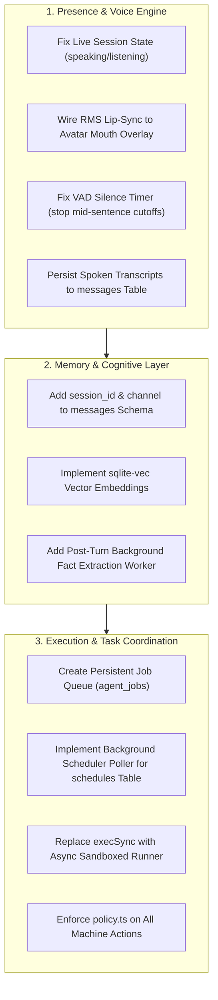

# MASTER AUDIT SYNTHESIS: PRODUCT GAP ANALYSIS & MISSING CAPABILITIES
**Audit Deliverable**: `audit/09-missing-capabilities.md`  
**Standard**: JARVIS Production Standard (Omnipresent, Autonomous, Context-Aware, Safe Multi-Modal Assistant)  
**Date**: November 2026  
**Auditor**: Principal Architecture & Product Review Board  

---

## 1. The JARVIS Benchmark Standard

An authentic, production-grade JARVIS personal assistant requires five non-negotiable capabilities:
1. **Omnipresent Voice & Visual Presence**: Sub-300ms latency, zero-friction hands-free operation, accurate lip-sync and expressive visual embodiment, and continuous conversation across all views without interruption.
2. **Deep Episodic & Semantic Long-Term Memory**: Autonomous fact extraction from dialogue, temporal grounding, vector search over years of activity, and seamless continuity between voice, text, and workstation contexts.
3. **Autonomous Task Execution & Delegation**: Asynchronous background workers, multi-agent task queues, DAG planners, real machine robotics, and non-blocking tool execution.
4. **Proactive Environmental Sensing & Intervention**: Real-time awareness of user focus, application activity, deadlines, and biometric state, intervening with timely context-aware assistance without manual prompts.
5. **Absolute Security, Safety & Human Authority**: Strict policy rungs, sandbox isolation, cryptographic authentication, and zero arbitrary shell execution without user sign-off.

---

## 2. Capabilities Inventory: Claimed vs. Actual Reality

| Capability Domain | Claimed / Advertised Feature | Implementation Reality in Codebase | Gap Assessment |
| :--- | :--- | :--- | :--- |
| **3D Embodiment** | 3D Digital Human (VRM, Three.js, FACS lip-sync) | 2D PNG/WebP images with static CSS mouth pill. 0 Three.js code in `src/`. | **Ghost Spec / 100% Simulated** |
| **Full-Duplex Voice** | Sub-300ms conversational voice, VAD, barge-in | ~650ms TTFA. VAD premature cutoff cuts user off mid-sentence. Mouth never moves. | **Partially Functional / Defective** |
| **Voice Persistence** | Voice conversations remembered across sessions | **Zero transcripts saved**. Spoken dialogue vanishes completely on hang up. | **TOTAL CAPABILITY ABSENCE** |
| **Session Isolation** | Multi-device, multi-session conversation threads | Single global `messages` table with no `session_id`. All tabs/devices collide. | **TOTAL CAPABILITY ABSENCE** |
| **Long-Term Memory** | Cognitive vector memory vault with semantic search | 4 hardcoded pinned notes; SQL `LIKE %query%` matching; zero vector embeddings. | **Primitive Prototype (10% standard)** |
| **Multi-Agent Runtime** | Sofia orchestrating Hermes and PC agents | Monolithic sequential loop (`processSofiaBrainTurn`). Flat chat dispatch to Hermes. | **Architectural Illusion** |
| **Background Scheduler** | Autonomous cron execution via `schedules` table | Rows are inserted into `schedules`, but **no poller or scheduler daemon runs them**. | **Dead Code / Placebo** |
| **Machine Control (CUA)**| Desktop robotics (click, type, key, screenshot) | `click`, `type`, `key` send chat prompts to LLM. Local `computer_run` executes bash unsandboxed. | **Insecure & Broken Protocol** |
| **Proactive Nudges** | Proactive intervention based on focus state | Internal proactive engine logs to `screen`. Telegram push only occurs via external cron HTTP call. | **Fragmented / Partially Wired** |
| **Administrative Actions**| Hot reload, Obsidian sync, Wazuh alert monitoring | `restart-sofia`, `sync-obsidian-vault`, `tail-wazuh-alerts` return hardcoded mock strings. | **Mocks / Stubs** |

---

## 3. Detailed Breakdown of Architectural Illusions

### 3.1 The 3D VRM Digital Human Ghost Spec
- **Documentation Claim**: `reports/uiux/3D-AVATAR-ARCHITECTURE-SPEC.md` claims a 3D digital human avatar powered by `@pixiv/three-vrm` and `public/models/sofia.vrm` is "production ready".
- **Code Reality**: Commit `195306ef` explicitly deleted the 3D stack. `public/models/` does not exist on disk. `src/components/SofiaAvatar.tsx` renders 2D WebP images. Yet `package.json` retains `three`, `@pixiv/three-vrm`, and `@types/three` (~150MB dead dependencies).

### 3.2 The Dead Code Scheduler (`schedules` Table)
- **Database Claim**: `src/lib/db.ts:150-159` defines `schedules` table with cron expressions. `src/lib/tools.ts:744-762` allows creating schedules via `hermes_schedule_create`.
- **Code Reality**: A repository-wide audit reveals **zero background timers or cron pollers query this table**. Schedulers are inserted into the database and permanently ignored.

### 3.3 The Mock Action Handlers
In `src/lib/actions/`:
- `sync-obsidian-vault.ts:1-19`: Returns `"Obsidian vault synchronization verified: 142 notes..."` without touching the filesystem.
- `restart-sofia.ts:1-7`: Returns `"Sofia services signaled for rolling reload..."` without signaling any process.
- `tail-wazuh-alerts.ts:1-29`: Returns a static array of 3 fake alerts with dynamically generated timestamps.

### 3.4 Cross-Channel Conversational Amnesia
When interacting via Gemini Live voice (`src/lib/live/session.ts`):
- Spoken transcripts stream into browser memory only.
- Audio and user speech are **never written to the SQLite `messages` table**.
- Navigating to `/chat` or checking the Stage shows zero record of the voice conversation.
- If the session disconnects or reaches the 40-minute limit, all conversational context evaporates.

---

## 4. Gap Roadmap towards Jarvis Standard

Implementing this roadmap transforms Sofia from a conversational prototype with mock actions into a genuine, production-quality Jarvis AI assistant.
