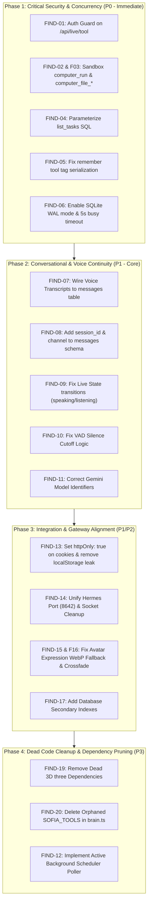

# MASTER AUDIT SYNTHESIS: PHASED REMEDIATION ROADMAP
**Audit Deliverable**: `audit/14-remediation-roadmap.md`  
**System**: JARVIS / Sofia Platform  
**Date**: November 2026  
**Auditor**: Principal Architecture & Engineering Execution Board  

---

## 1. Phased Remediation Dependency Graph

---

## 2. Remediation Execution Plan by Phase

### Phase 1: Critical Security & Concurrency (P0 — Immediate Execution)
- **Goal**: Close RCE vulnerabilities, eliminate database locking crashes, and fix data corruption bugs.
- **Actions**:
  1. Add `verifyApiAuth` to `src/app/api/live/tool/route.ts`.
  2. Implement strict command gating in `src/lib/tools.ts` for `computer_run` and workspace bounds for `computer_file_*`.
  3. Parameterize `list_tasks` SQL queries in `src/lib/tools.ts` and `src/lib/brain.ts`.
  4. Fix `remember` tool tag serialization (`JSON.stringify([args.tags || 'conversation'])`).
  5. Enable `PRAGMA journal_mode = WAL;` and `PRAGMA busy_timeout = 5000;` in `src/lib/db.ts`.

### Phase 2: Conversational & Voice Continuity (P1 — Core)
- **Goal**: Make voice interactions persistent, eliminate conversational amnesia, and fix avatar speech reactivity.
- **Actions**:
  1. Add `session_id` and `channel` to `messages` table in `src/lib/db.ts`.
  2. Implement transcript logging in `src/lib/live/session.ts` to push voice turns into `/api/chat`.
  3. Update `session.ts` to call `this.setState('speaking')` and `this.setState('listening')` in lockstep with audio playback.
  4. Correct the VAD silence detection logic in `session.ts` (replace `now - userSpeechStartTime > 300` with `lastVoiceActiveTime`).
  5. Replace invalid model names in `src/lib/brain.ts` (`gemini-2.0-flash` or `gemini-1.5-flash`) and `src/lib/live/config.ts`.

### Phase 3: Integration & Gateway Alignment (P1/P2)
- **Goal**: Harden authentication headers, unify the Hermes machine control gateway, and polish avatar expressions.
- **Actions**:
  1. Set `httpOnly: true` on `sofia_token` cookie and eliminate token reflection in `/api/auth`.
  2. Align `scripts/hermes-relay.py` target to port `8642` and ensure sockets close on failure.
  3. Fix avatar image fallback to `.webp` and restore smooth crossfade opacity transitions in `SofiaAvatar.tsx`.
  4. Add secondary indexes on `events(ts)`, `tasks(status)`, `messages(ts)`, and `memory_notes(pinned)`.

### Phase 4: Hygiene & Maintenance (P3)
- **Goal**: Prune dead dependencies and eliminate redundant code.
- **Actions**:
  1. Run `pnpm remove three @pixiv/three-vrm @types/three`.
  2. Delete legacy `SOFIA_TOOLS` and `executeSofiaTool` from `src/lib/brain.ts`.
  3. Wire background runner for `schedules` table in Next.js server lifecycle.
